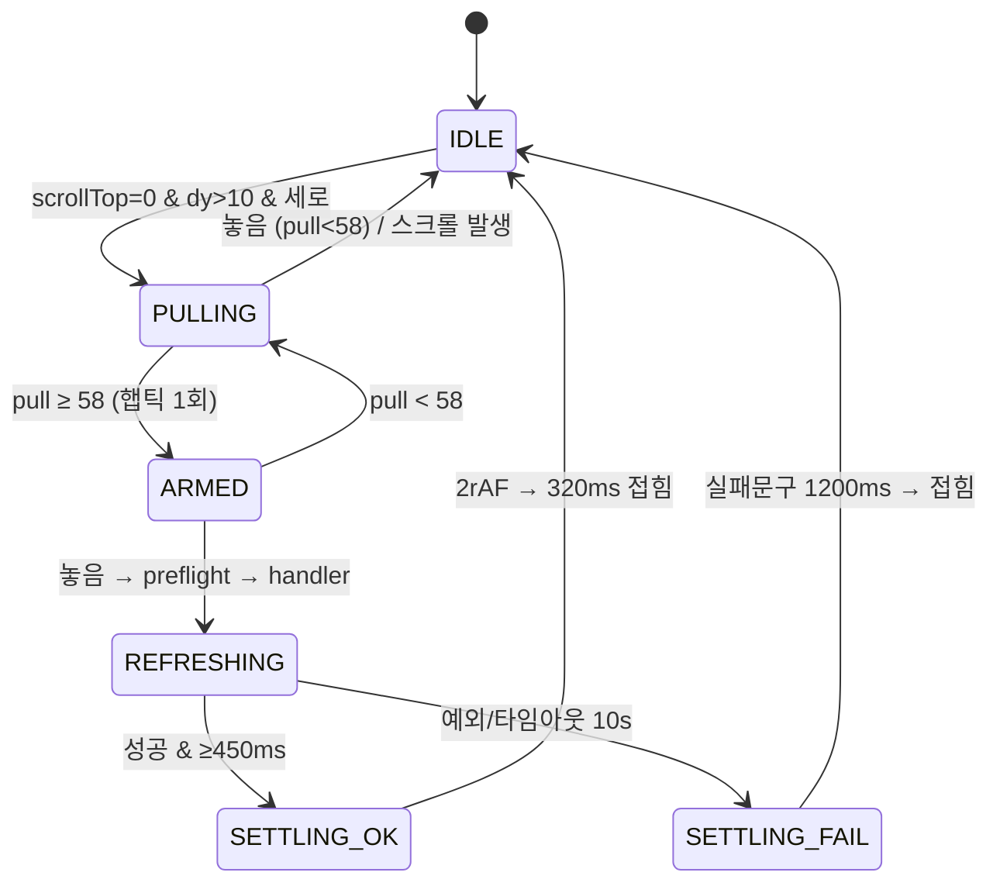

# DIBAY Pull-to-Refresh(PTR) — 감사 보고 · 설계안 (스핀 · 텍스트 · 광고 리빌 · 이미지 비율)

Document status: **AUDIT 완료 · DESIGN PROPOSAL (Owner 승인 전, 구현 0)**
Date: 2026-10-12
범위: 메인 허브 「아래로 당겨 새로고침」 — 기능 감사, 버퍼링 스핀, 문구, PTR 영역 광고(리빌 배너), 글로벌 팝업 광고와의 관계, iOS · Android APK · 태블릿 이미지 비율.

증거 라벨(기존 `dibay-global-popup-ad-measured-geometry-lock.md` §1 규칙 준수):

| 라벨 | 의미 |
|---|---|
| `CODE_FACT` | 이 저장소 코드에서 직접 확인 |
| `LEGACY_PUBLIC_OBSERVATION` | 네이버·배민 등 공개 관찰 기반 UX 패턴 (런타임 측정 **아님**, 픽셀 근거로 쓰지 않음) |
| `DIBAY_DESIGN_PROPOSAL` | 본 문서가 제안하는 DIBAY 제품 정책 / 캘리브레이션 값 (Owner 승인 필요) |

---

## 1. 현재 구현 감사 (`CODE_FACT`)

### 1.1 PTR 이 동작하는 화면 (정확한 새로고침 영역)

라우트 → 도메인 판정 SSOT: `lib/layout/resolve-main-hub-ptr-domain.ts` (동시에 하나의 도메인만 `preventDefault` 리스너 부착).
적격/보류 맵: `lib/ui/dibay-pull-refresh-eligibility.ts`.

| # | 화면(라우트) | 도메인 | 제스처 훅 (리스너) | 힌트 슬롯 위치 · 배경 | 새로고침 핸들러가 **실제로 다시 받는 것** | 새로고침 **안 되는 것** |
|---|---|---|---|---|---|---|
| 1 | `/market` (거래 홈) | trade | `lib/trade/use-trade-market-pull-refresh.ts` → 스크롤 루트 capture | `AppStickyHeader` 1단(RegionBar)·2단(TradePrimaryTabs) 사이 · `bg-signature` | `HomeProductList.onPullRefresh`: `invalidateHomePostsCache` → 프레젠테이션 세션 삭제 → `load({forceFreshRankedWindow, replaceList})` (상품 목록 1페이지 재요청, 페이지네이션·새글 카운트 리셋) | 피드 광고 풀(`/api/feed-ads/active`), 상단 RegionBar·탭 |
| 2 | `/market/[slug]` (카테고리·주제) | trade | 동일 (routeKey = 경로 + committed query) | 동일 | `PostListByCategory.onPullRefresh`: `invalidateHomePostsCache` → `load(1, {forceFreshRankedWindow})` | 피드 광고, 카테고리 칩 |
| 3 | `/`, `/philife` (커뮤니티 피드) | philife | `lib/philife/use-philife-pull-refresh.ts` | 1단·2단(주제 탭) 사이 · `bg-signature` | `CommunityFeed.onPhilifePullRefresh`: 피드 캐시 엔트리·이웃 TTL·주제옵션 캐시 무효화 → `fetchPage(0)` + 주제 칩 재요청 (병렬) | **상단 광고(`/api/ads/active?boardKey=plife`)** — 카테고리 변경 시에만 로드 |
| 4 | `/stores` (배달 홈) | stores | `lib/stores/use-stores-home-pull-refresh.ts` | `StoresHomeHeaderChrome` 녹색 헤더 내부 확장 · 헤더색 | 핸들러 **3개 병렬**: ① `StoresHomeHub` `loadFeed({force})` ② `StoresHomeQuickCategories` 택소노미 캐시 삭제·재요청 ③ `StoresHub` `loadBuyerHub({force})` (주문 요약) | 히어로 배너(`StoresHomeHeroBanner`), 인서션 배너 |
| 5 | `/stores/browse/*` | stores_browse | `lib/stores/use-stores-browse-pull-refresh.ts` | browse 4·5단 사이 · `#eac784` | `StoresBrowsePrimaryView.onBrowsePullRefresh`: 메모리/클라이언트/세션 캐시·single-flight 무효화 → 택소노미 + 목록 `loadRemote({force})` | 검색 상단 배너 |
| 6 | `/community-messenger` (홈) | messenger | `lib/community-messenger/use-messenger-pull-refresh.ts` | 1단·2단(섹션 탭) 사이 · `bg-signature` | `runMessengerHomePullRefresh`: `clearBootstrapCache()` → `refresh(false)` (비-silent 부트스트랩) | — (방·통화 화면은 PTR 제외) |
| 7 | 사장님 대시보드 | (레거시) | `lib/ui/use-pull-to-refresh-document-top.ts` (window 리스너) | 대시보드 자체 | `invalidateOwnerHubOrderCountsCache` → `loadRemote()` + `loadOpsSnapshot({force})` | — |

제외(HOLD): 거래 `trade-meet-spot`·`location`, 메신저 방/통화, 대부분의 마이페이지, 지도, 정적 페이지 (`DIBAY_PTR_HOLD_REASON`).

### 1.2 공통 물리값 (1~6번 공유, SSOT = `lib/stores/stores-home-pull-refresh-store.ts`)

| 상수 | 값 | 의미 |
|---|---|---|
| `PULL_ENGAGE_PX` | 10 | 당김 인식 시작 (세로 판정 `dy ≥ |dx|×0.8`) |
| `compute…PullPxFromTouchDy` | `106 × (1 − e^(−0.48·dy / (106×0.62)))` | 러버밴드 감쇠 |
| `THRESHOLD_PX` | 58 | 놓으면 새로고침 임계 |
| `MAX_PX` | 106 | 슬롯 최대 높이 |
| `SLOT_PX` | 52 | 새로고침 중 유지 높이 하한 (실제 유지 = `max(release, 58, 52)` ≤ 106) |
| `MIN_SPIN_MS` | 450 | 스피너 최소 노출 |
| `COLLAPSE_MS` | 320 | 접힘 전환 |
| 힌트 최소 표시 | `pullPx > 2` | |

흐름: `touchstart(scrollTop=0)` → `touchmove`(preventDefault, pullPx 갱신, 0.25×임계 초과 시 클릭 억제) → `touchend` → 임계 이상이면 `preflight`(스크롤 0) → 핸들러 → 최소 450ms 대기 → 2 rAF → 접힘.

### 1.3 감사 발견 사항

| ID | 심각도 | 발견 | 근거 |
|---|---|---|---|
| F1 | 높음 | **동일 로직 5벌 복제** — 제스처 훅·스토어·힌트 컴포넌트가 도메인별로 복사됨 (diff 상 이름·routeKey 만 다름). 스핀/문구/광고를 넣으려면 5곳 동시 수정 필요 → SSOT 위반 | `use-*-pull-refresh.ts` ×5, `*-pull-refresh-store.ts` ×5, `*PullRefreshHint.tsx` ×4 + `StoresHomeHeaderChrome` 인라인 |
| F2 | 높음 | **스피너 2종 혼재** — 거래·browse 는 12점 버퍼링(`StoreDeliveryBufferingSpinner`), 커뮤니티·메신저·배달홈은 테두리 회전 링 | `TradeMarketPullRefreshHint`, `PhilifePullRefreshHint` |
| F3 | 높음 | **거래 PTR 스피너 대비 불량** — 12점 스피너는 점 색이 CSS 에 `#050505`/`#ced0d4` 하드코딩이라 `className="text-white"` 가 무효 → 보라(`bg-signature`) 배경 위에 검정·회색 점 | `StoreDeliveryBufferingSpinner.module.css` |
| F4 | 중간 | **사장님 대시보드만 다른 물리** — 선형 0.42 감쇠, 임계 52, 상한 100, window 리스너, 최소 스핀·클릭 억제 없음 | `use-pull-to-refresh-document-top.ts` |
| F5 | 중간 | **광고는 PTR 로 갱신되지 않음** — 커뮤니티 상단 광고, 거래 피드 광고 풀, 배달 히어로 배너 모두 핸들러 밖 | §1.1 표 |
| F6 | 중간 | **결과 피드백 없음** — 핸들러 실패해도 조용히 접힘(토스트·문구 없음), 성공 시 "업데이트됨" 표시 없음 | `run*PullRefresh` `finally` |
| F7 | 낮음 | 임계 통과 시 **햅틱 없음** (`lib/ui/light-tap-feedback.ts` SSOT 존재하나 미사용) | |
| F8 | 낮음 | 문구 키가 `store_home_pull_*` — 전 도메인 공용인데 배달 네임스페이스 | `lib/i18n/catalog/store-commerce-ui.ts` |
| F9 | 낮음 | `prefers-reduced-motion` 미대응 (스핀·러버밴드) | |
| F10 | 정보 | 당김 중 진행률 표시 없음 — 문구만 2단계(당겨서/놓으면) 변경, 스피너는 새로고침 시점에만 등장 | 힌트 컴포넌트 |

---

## 2. 레거시 앱 벤치마크 (`LEGACY_PUBLIC_OBSERVATION`)

> 아래는 공개적으로 알려진 UX 패턴 정리이며 **런타임 측정값이 아니다.** 픽셀·타이밍 근거로 인용 금지. 배민·네이버 로고·캐릭터·색·카피 복제 금지(팝업 계약 §2 와 동일).

| 패턴 | 네이버 | 배민 | 카카오톡 / 당근 | DIBAY 채택 여부 |
|---|---|---|---|---|
| 당김 중 진행 표시(결정형) | 원형 인디케이터가 당김에 비례해 채워짐 | 브랜드 캐릭터/일러스트가 당김에 따라 드러남 | 플랫폼 기본 스피너 | **채택** — 12점이 진행률만큼 점등 |
| 임계 통과 신호 | 인디케이터 완성 + 미세 햅틱 | 캐릭터 동작 변화 | iOS 기본 햅틱 | **채택** — 전점 점등 + 1.06 스케일 + `light` 햅틱 1회 |
| 새로고침 중 | 무한 회전 | 브랜드 애니메이션 | 회전 | **채택** — 기존 12점 버퍼링 회전 |
| 당김 영역 브랜딩/광고 | 메인 상단 특집 이미지(시즌·이벤트) 노출 사례 | 상단 영역에 프로모션 이미지 노출 사례 | 없음 | **조건부 채택** — §4 리빌 배너 (메신저 제외) |
| 완료 피드백 | 목록 교체 | 목록 교체 | 목록 교체 | **채택** — 실패 시에만 문구 1.2s (성공은 목록 교체로 충분) |
| PTR 이 전면 팝업을 띄움 | 아니오 | 아니오 (팝업은 홈 진입 시) | 아니오 | **금지** — §5 |

---

## 3. 설계안 — PTR SSOT (`DIBAY_DESIGN_PROPOSAL`)

### 3.1 단일 모듈 구조 (F1 해소)

```text
lib/ui/ptr/
  dibay-ptr-ssot.ts          — 물리 상수·페이즈·문구 키·광고 지오메트리 (유일한 숫자 출처)
  create-dibay-ptr-store.ts  — 도메인별 인스턴스 팩토리 (snapshot/subscribe/handlers/run)
  use-dibay-ptr-gesture.ts   — 제스처 훅 1벌 (domain, resolveRouteKey?, enabled)
components/ptr/
  DibayPtrSlot.tsx           — 힌트 슬롯 1벌 (tone: "brand" | "delivery-header" | "browse")
  DibayPtrSpinner.tsx        — 결정형/무한 12점 스피너 1벌
  DibayPtrRevealAd.tsx       — 리빌 배너 레이어 (§4)
```

기존 `*PullRefreshRegister` / `*PullRefreshHost` 와 `resolveMainHubPtrDomain` 은 **API 유지**, 내부만 팩토리 인스턴스로 교체 → 도메인 화면 코드 변경 최소. 사장님 대시보드(F4)도 동일 훅 + `document` 루트 옵션으로 흡수.

### 3.2 페이즈(상태 머신)



| 페이즈 | 슬롯 높이 | 스피너 | 문구 키 (ko / en) | 광고 레이어 |
|---|---|---|---|---|
| PULLING | `pullPx` (0~106) | 결정형: 점등 수 = `ceil(12 × pull/58)` , 회전 없음 | `ptr_pull_hint` 당겨서 새로고침 / Pull down to refresh | pull ≥ 24 부터 페이드인 (opacity = (pull−24)/34) |
| ARMED | `pullPx` | 12점 전부 점등 + scale 1.06 (120ms) | `ptr_release` 놓으면 새로고침 / Release to refresh | 100% |
| REFRESHING | `max(release, 58)` (광고 시 `max(release, 76)`) | 무한 버퍼링 회전 1.15s | `ptr_refreshing` 새로고침 중… / Refreshing… | 100% + 탭 가능 |
| SETTLING_FAIL | 유지 | 숨김 | `ptr_failed` 새로고침하지 못했어요 / Couldn't refresh | 100% |
| (reduced-motion) | 동일 | 회전 대신 점 opacity 펄스 | 동일 | 페이드 없이 on/off |

새로고침 핸들러 계약 추가: 핸들러는 실패 시 throw (현재 대부분 내부에서 삼킴 → `load` 결과를 `ok:boolean` 으로 반환하도록 정렬), 상한 10s 후 SETTLING_FAIL.

### 3.3 스피너 SSOT (F2·F3 해소)

| 항목 | 값 |
|---|---|
| 형태 | 기존 12점 링 유지 (`StoreDeliveryBufferingSpinner` 로직 이관) — 배달 목록 로딩과 동일 언어 |
| 크기 | 24 × 24 CSS px (점 3.2px, 반경 9px). 현재 44px 는 58px 슬롯에서 문구와 겹칠 여지 → 축소 |
| 톤 토큰 | `onBrand`: 활성 `#FFFFFF`, 비활성 `rgba(255,255,255,.35)` (보라·녹색 헤더) / `onSurface`: 기존 `#050505`/`#ced0d4` (+ 다크 기존값) / `onBrowse`: 활성 `#362415` |
| 색 주입 | CSS 변수 `--ptr-dot-on`, `--ptr-dot-off` (하드코딩 제거 → F3 해소) |
| 결정형 | `data-progress` 0~12, 점 i < n 이면 on 색 |

### 3.4 문구 SSOT (F8 해소)

`lib/i18n/catalog/` 에 `ptr_*` 공용 키 신설, `store_home_pull_*` 는 별칭으로 1 릴리스 유지 후 제거.

| 키 | ko | en |
|---|---|---|
| `ptr_pull_hint` | 당겨서 새로고침 | Pull down to refresh |
| `ptr_release` | 놓으면 새로고침 | Release to refresh |
| `ptr_refreshing` | 새로고침 중… | Refreshing… |
| `ptr_failed` | 새로고침하지 못했어요 | Couldn't refresh |
| `ptr_ad_label` | 광고 | Ad |

타이포: 13px / 500 / leading-snug (현행 유지). 광고 모드에서는 상태 pill 안 12px.

---

## 4. PTR 리빌 배너 (광고 삽입 설계, `DIBAY_DESIGN_PROPOSAL`)

### 4.1 제품 정의

- **명칭**: `PTR_REVEAL` 배너 — 당김으로 드러나는 슬롯 배경 크리에이티브. **팝업이 아니다.** (글로벌 팝업 = 홈 진입형 전면 광고, 별도 계약)
- **노출 면**: COMMUNITY(`/philife`), TRADE(`/market` 홈만, v1), DELIVERY(`/stores` 홈 헤더, browse 는 v2).
  **제외**: MESSENGER(팝업 계약 §3 의 광고 제외면과 동일 원칙), 사장님 대시보드, 카테고리 상세.
- **용량**: `BANNER_PLACEMENT_CAPACITY_SSOT` 에 `PTR_REVEAL_{COMMUNITY,TRADE,DELIVERY}` 추가 — `max 3, visibleAtOnce 1, rotationMode "per_pull_ordered"`(당김 1회 = 다음 캠페인), `fallback: "COLLAPSE_SLOT"`(= 현행 단색 슬롯), `houseAdUiAllowed: false`.
- **빈도**: 같은 앱 세션에서 PTR 3회당 1회 노출(1·4·7번째 당김), 세션당 최대 5회. 나머지 당김은 현행 단색 슬롯.

### 4.2 레이아웃 (슬롯 내부 레이어)

```text
┌──────────── 앱 콘텐츠 폭 ────────────┐  ← 슬롯 (높이 = pullPx, 최대 106)
│ [creative: 세로 중앙 고정, cover]     │
│        핵심 메시지 영역 (상단 48px)    │
│   ┌──────────────────────────┐      │
│   │ ◌ 새로고침 중…        광고 │      │  ← 상태 pill: 높이 28, 하단 6px, 반투명 scrim
│   └──────────────────────────┘      │
└─────────────────────────────────────┘
──────── 2단 탭 (기하 변형 금지) ────────
```

- 크리에이티브는 **슬롯 높이 106px 고정 크기**로 렌더하고 세로 중앙 정렬 → 당김에 따라 중앙에서 위아래로 열리는 "창문" 리빌 (이미지 스케일이 손가락에 따라 변하지 않음 = 저렴한 합성, 레이아웃 무변형).
- 광고 노출 시 새로고침 유지 높이 = `max(release, 76)` (문구 pill + 메시지 영역 확보).
- 상태 pill: `rgba(0,0,0,.45)` + `backdrop-blur(6px)`, 흰 스피너(16px)·흰 문구 12px, 우측 `광고` 라벨 (표시 의무).
- 헤더(1단)·2단 탭 기하 변형 금지 (eligibility 파일 규칙 유지).

### 4.3 CTA

| 상황 | 동작 |
|---|---|
| PULLING / ARMED | 탭 불가 (손가락이 화면에 있음, 기존 클릭 억제 유지) |
| REFRESHING ~ 접힘 직전 | 크리에이티브 탭 → 랜딩 (기존 `lib/ads/feed-ad-destination.ts` 해석기 재사용, **fail-closed**: 유효 랜딩 없으면 탭 비활성) |
| 탭 직후 | PTR 은 계속 진행(새로고침 취소하지 않음), 랜딩은 다음 rAF 에 push |
| 접힘 후 | CTA 소멸 (재노출은 다음 당김 순번) |

### 4.4 노출·과금 측정

- `ptr_reveal_view`: 크리에이티브 가시 면적 ≥ 50% 가 누적 ≥ 500ms (REFRESHING 최소 450ms + 접힘 320ms 로 대부분 충족). IAB 1초 기준과 다르므로 **PTR 전용 지표**로 명시, 판매 시 CPM 아닌 고정 기간가 권장.
- `ptr_reveal_click`: CTA 탭. 이벤트 기록은 기존 광고 이벤트 writer 계열 재사용, 신규 테이블은 구현 CUT 에서 결정.
- **광고 때문에 새로고침을 지연하지 않는다**: 데이터가 먼저 오면 MIN_SPIN(450ms) 만 지키고 접는다 (성능 헌장 우선).

### 4.5 사전 로드 (깜빡임 0)

- 면 마운트 후 idle 시 `/api/…/ptr-reveal/active` 1회 single-flight → 이미지 `new Image()` + `decode()` 완료분만 후보.
- 당김 시점에 decode 미완료 → 그 회차는 광고 없이 단색 슬롯 (빈 박스·로딩 스켈레톤 노출 금지).
- PTR 실행 시 다음 순번 후보를 다시 decode (피드 광고 세션 `getOrCreateFeedAdSessionId` 규약처럼 세션 id 는 유지).

### 4.6 F5 (기존 광고 갱신) 처리

- PTR 핸들러에 **피드 광고 풀 재요청 포함** (거래 `feedAdPool`, 커뮤니티 `topAds`): 세션 id 유지 → 로테이션만 전진. 배달 히어로 배너도 `addStoresHomePullRefreshHandler` 로 등록.

---

## 5. 글로벌 팝업 광고와의 관계 (기존 계약 준수)

근거: `docs/dibay-global-popup-ad-product-contract-lock.md`, `lib/platform-popup/*`, `components/platform-popup/GlobalPopupHost.tsx`.

| 규칙 | 내용 |
|---|---|
| P1 | **PTR 은 팝업 트리거가 아니다.** PTR 로 앱 세션·`popup-app-session` 을 리셋하지 않으며 resolve 재요청도 하지 않는다 |
| P2 | PTR 페이즈 ≠ IDLE 동안 팝업 표시 **DEFER** — `critical-ui-context` 에 일시 플래그 `ptrGestureActive` 추가 → 기존 `DEFER/INVALIDATE` 경로 재사용 (z-index 로 해결 금지) |
| P3 | 팝업 VISIBLE 중 PTR 비활성 (백드롭이 터치를 가져가므로 사실상 자동, 훅에서도 명시 가드) |
| P4 | 리빌 배너와 팝업이 같은 캠페인/광고주일 때 같은 세션에서 중복 노출 금지 (충돌 규칙: 팝업 우선, 리빌 배너는 다음 후보로) |

---

## 6. 이미지 규격 · 기기별 비율 (iOS · Android APK · 태블릿)

### 6.1 렌더 박스 (CSS px)

| 기기 클래스 | 콘텐츠 폭 W | 슬롯 최대 H | 실 렌더 박스 | 박스 비율 | DPR | 비고 |
|---|---|---|---|---|---|---|
| 소형 폰 (Android 360) | 360 | 106 | 360 × 106 | 3.40 : 1 | 2.0~3.0 | APK WebView |
| 표준 폰 (iPhone 390~393) | 390 | 106 | 390 × 106 | 3.68 : 1 | 3.0 | WKWebView |
| 대형 폰 (430) | 430 | 106 | 427 × 106 (캔버스 폭) + 좌우 1.5px 배경색 | 4.0 : 1 | 3.0 | |
| 폴더블 펼침·태블릿 세로 (≥ 600) | 600~1056 | 106 | **최대 폭 480 중앙 고정** + 좌우 `creative.bgColor` 채움 | 4.53 : 1 (박스) | 2.0 | 팝업 T1 정책(480)과 동일 원칙 |
| 가로(landscape) | — | — | **리빌 배너 비노출** (단색 슬롯) | — | — | 팝업 L1 정책과 동일 |

> 단일 크리에이티브를 `cover` 로 폭 1056 까지 늘리면 세로가 30% 미만만 보임 → 태블릿은 늘리지 않고 **경계 폭 + 배경색 확장**. 이것이 iOS·APK·태블릿 단일 렌더러 / 단일 업로드를 가능하게 하는 핵심.

### 6.2 업로드 규격 (1개 파일로 전 기기 대응)

| 항목 | 값 |
|---|---|
| 캔버스 | **1280 × 320 px (4 : 1)** = CSS 427×107 @3x |
| 포맷 / 용량 | WebP 권장(JPEG 허용), **≤ 150 KB** (당김 전 사전 decode 필요), sRGB, 투명 금지 |
| 필수 메타 | `bgColor` (#RRGGBB) — 태블릿 좌우 채움·로드 전 배경. 크리에이티브 좌우 가장자리 색과 일치 |
| 핵심 메시지 안전영역 | x 140~1140, y 46~190 (1000 × 144) — 폰 360 크롭과 새로고침 유지 높이 76 기준 |
| 상태 pill 금지영역 | x 430~850, y 190~274 — 문구·로고 배치 금지 (pill 이 덮음) |
| 리빌 시작 영역 | y 125~195 (중앙 70px = CSS 24px) — 처음 드러나는 부분, 로고/브랜드 컬러 권장 |
| 금지 | 이미지 속 "새로고침" 등 시스템 문구 흉내, 스피너 모양 그래픽, 타사 로고 |

검증 공식 (구현 시 테스트로 고정):

```text
renderBoxW = min(contentW, 480)            # 태블릿 경계
scale      = max(renderBoxW / 427, 106 / 107)   # cover
visibleSrcX = 1280 × (renderBoxW / (427 × scale))   # 360 폭 → ≈1079 → 안전영역 1000 포함
holdBandSrcH = 320 × (76 / 107) ≈ 227  → y 46~274 (중앙 정렬)
```

### 6.3 플랫폼별 주의

| 플랫폼 | 처리 |
|---|---|
| iOS (Capacitor WKWebView) | 네이티브 바운스는 `globals.css` `overscroll-behavior-y: none` + 스크롤 루트 `contain` 로 이미 차단 → JS PTR 단독. 햅틱은 `light-tap-feedback` (coarse pointer 한정). 슬롯은 헤더 아래이므로 safe-area 추가 보정 불필요 |
| Android APK (WebView) | 오버스크롤 글로우 동일 차단. DPR 2.625/3.5 기기도 @3x 1장으로 충분(1.17배 미만 업스케일). 뒤로가기: 슬롯은 모달이 아니므로 영향 없음 |
| 태블릿 | 6.1 경계 폭 480. 마우스/트랙패드(fine pointer)는 PTR 비활성 유지(터치 이벤트만 사용 — 현행과 동일) |
| 다크 모드 | 크리에이티브는 단일, 상태 pill scrim 이 대비 보장. 단색 슬롯은 기존 토큰(`bg-signature`) |

---

## 7. 구현 단계 제안 (각 단계 독립 PR)

| CUT | 내용 | 검증 |
|---|---|---|
| PTR-1 | `lib/ui/ptr` SSOT + 팩토리로 5개 도메인·대시보드 통합 (동작 동일, 숫자 불변) | 기존 `stores-home-pull-refresh-store`·`trade-market-pull-refresh-*`·`marketplace-browse-ptr-contract` 테스트 + 팩토리 단위테스트 |
| PTR-2 | `DibayPtrSpinner` 결정형·톤 토큰, 햅틱, reduced-motion, `ptr_*` 문구, 실패 페이즈 | 스냅샷/단위테스트, Playwright 모바일 뷰포트 터치 시나리오 |
| PTR-3 | 기존 광고 PTR 갱신 (F5) | 피드 광고 세션 id 불변 테스트 |
| PTR-4 | 글로벌 팝업 DEFER 연동 (§5 P2·P3) | `popup-host-machine` 리듀서 테스트 추가 |
| PTR-5 | `PTR_REVEAL` 배치·관리자 업로드(1280×320, bgColor, 안전영역 가이드 오버레이)·리졸버·이벤트 | 지오메트리 공식 테스트(§6.2), 관리자 미리보기 3기기 프레임 |

성능: PTR-1~4 는 hot-path(목록 상단 제스처) 변경이므로 `docs/samarket-parity-execution-order.md` 의 해당 게이트 적용. PTR-5 는 사전 decode·single-flight 로 첫 페인트·메인 fetch 경합 0 을 수용 조건으로 둔다.

---

## 8. Owner 결정 필요 항목

1. 리빌 배너 노출 빈도 (제안: 3당김당 1회, 세션 5회)
2. 거래 카테고리·배달 browse 면 포함 여부 (제안: v2)
3. 판매 단위 (제안: 고정 기간가 — PTR 전용 지표라 CPM 비권장)
4. 태블릿 경계 폭 480 을 팝업 T1 토큰(`PLATFORM_POPUP_TABLET_MAX_WIDTH_PX`)과 공유할지, 별도 토큰으로 둘지
5. 성공 시 "방금 업데이트됨" 문구 표시 여부 (제안: 미표시 — 목록 교체가 피드백)
