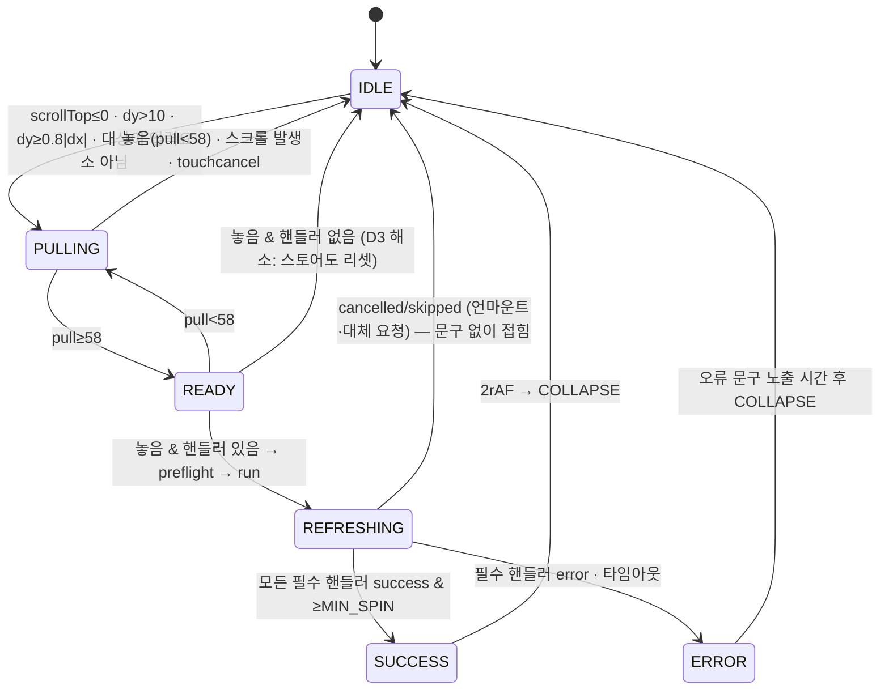

# DIBAY Pull-to-Refresh(PTR) — 최종 설계 보고서 (설계 확정 전 검증판)

Document status: **v3 — PTR 정상화 구현 완료(§10, 미커밋) · 광고 정책 Owner 승인 대기 · DB 변경 0**
Date: 2026-10-12 (v2 감사 `4332d8d0` 보존 + §10 구현·검증 결과 추가)
범위: 메인 허브 「아래로 당겨 새로고침」 — 기능 정확성, 공통 UI/UX, 광고 연동, 기기별 이미지 비율, 레거시 비교.

## 0. 증거 등급 · v1 정정 사항

| 라벨 | 의미 |
|---|---|
| `CODE_VERIFIED` | 이 보고서 작성자가 해당 file:line 을 직접 열어 확인 |
| `CODE_TRACED` | 코드 경로 추적(호출 체인·조건 분기)으로 도출. 런타임 실행·화면 관측은 **안 함** |
| `COMPUTED` | 코드상 CSS/상수 값으로 계산. 실제 렌더 스크린샷 미확인 |
| `UNVERIFIED` | 코드·자료로 확인 불가. 사실로 쓰지 않음 |
| `PROPOSAL` | 본 문서의 설계 제안. Owner 승인 전 효력 없음 |
| `RUNTIME: NOT_PROVEN` | 실기기·브라우저에서 재현·관측하지 않음. 코드 근거와 별개로 런타임 증상은 미증명 |

**모든 결함(D1~D25)은 코드 기반 판정이며 런타임 상태는 전부 `NOT_PROVEN` 이다. 실기기(iOS/APK/태블릿)·브라우저 재현은 아직 하지 않았다.** 9장 검증 계획에서 재현 후에만 PASS/FAIL 을 확정한다.

v1(`46a5725`, `ea7eaf2`) 대비 정정:

| v1 내용 | 정정 | 근거 |
|---|---|---|
| 거래/커뮤니티 슬롯 배경 "보라(`bg-signature`)" | **DIBAY 그린 `#0B421A`** (`--signature → --sam-primary → --sm-color-primary → --dibay-green`) | `app/design-tokens.css:10,20,68,269` CODE_VERIFIED |
| 레거시 비교표 "네이버: 원형 인디케이터 채움", "배민: 캐릭터 리빌" 등 | **근거 없음 — 철회.** 7장에서 UNVERIFIED 로 재분류 | 공개 검색 결과 해당 자료 없음 |
| 리빌 배너 빈도(3당김당 1회)·판매 방식·유지 높이 76px·1280×320 단일 규격 확정 | **확정 철회 → Owner 결정 항목(8장)** | 요청 원칙 |
| "새로고침 완료 = 핸들러 resolve" 전제 | 화면별로 resolve ≠ 렌더 완료인 경로 다수 확인(1장) | 1장 |
| 새로고침 중 유지 높이 "≥58" 만 기술 | 실제 유지 높이 = `min(106, max(releasePx, 58, 52))` → **58~106 사이 가변** (놓은 위치에 따라 다름) | `lib/stores/stores-home-pull-refresh-store.ts:40-45` CODE_VERIFIED |

---

## 1. 기존 화면별 실제 동작 감사표

### 1.1 공통 런타임 (`CODE_VERIFIED`)

- 도메인 판정: `lib/layout/resolve-main-hub-ptr-domain.ts:7-23` — `/market*`(trade-meet-spot·location 제외)=trade, `/`·`/philife`=philife, `/stores`=stores, `/community-messenger*`(rooms/:id, calls/:id 제외)=messenger. browse 는 `AppStickyHeader.tsx:135` 에서 별도 host.
- 물리 상수 SSOT `lib/stores/stores-home-pull-refresh-store.ts`: THRESHOLD 58(:20), MAX 106(:22), SLOT 52(:24), MIN_SPIN 450ms(:28), COLLAPSE 320ms(:30), 러버밴드 `106·(1−e^(−0.48dy/65.72))`(:33-38). 나머지 도메인은 alias.
- 제스처: 스크롤 루트(`getMainAppScrollRootCached` → `[data-main-hub-scroll-body]` 스크롤 가능 시, 아니면 `<main>`, 아니면 `documentElement` — `lib/ui/store-detail-scroll-root.ts:41-54`)에 capture 리스너, `touchmove passive:false`, 진입 `dy>10 && dy≥0.8|dx|`, input/textarea/select 제외, 임계 25% 초과 당김 후 `a/button/[role=tab]` 클릭 1회 억제.
- 실행기 `run*PullRefresh`: `refreshing` 또는 핸들러 없음이면 즉시 return → preflight(`scrollAppShellToTop`) → `refreshing:true` → `await handler(s)` (**try/finally, catch 없음**) → 최소 450ms → 2rAF → 접힘. **스냅샷은 `{pullPx, refreshing}` 뿐 — 성공/실패 채널 없음.** 타임아웃 없음.

### 1.2 화면별 감사표

| 화면 | 호출 API | 무효화 캐시 | 진행 중 요청 처리 | 기존 데이터 | 실패 시 화면 | "완료" 시점 실제 커밋 | 광고 갱신 |
|---|---|---|---|---|---|---|---|
| **`/market` 홈** (`HomeProductList.tsx:408-422`) | `GET /api/philife/posts?page=1…` + 헤더 `x-dibay-market-fresh-feed:1` (서버: ranked-window 세션·서버캐시 삭제 `home-posts-route-core.ts:629-633`) | `invalidateHomePostsCache` — single-flight `home-posts-fetch:*`, 메모리, session/localStorage(`getPostsForHome.ts:416-457`), 프레젠테이션 세션 | requestId 증가로 기존 응답 폐기. **진행 중 load-more 가 영구 잠김(D1)** | 유지(목록 스켈레톤 없음), 단 가시 윈도우는 즉시 1페이지로 축소 | **빈 목록 "empty" 상태(D2)** — 실패가 `{posts:[]}` 로 변환 | `setPosts` 후 resolve (`:363`) ✔ (superseded/위치 미설정 시 미커밋) | ✖ 피드광고 풀 deps `[]` (`:749-772`) |
| **`/market?category=…`** (`PostListByCategory.tsx:489-496`) | 동일 API | 동일(프레젠테이션 세션은 미삭제) | epoch 가드, abort 없음 | 유지 | **CategoryEmptyState(D2)** | `setPosts` 후 resolve (`:447`) ✔ | ✖ deps `[categoryId]` |
| **`/`·`/philife`** (`CommunityFeed.tsx:1089-1112`) | `GET /api/philife/neighborhood-feed?…` + `GET /api/philife/neighborhood-topic-options` 병렬 | 피드 localStorage 1엔트리, short-TTL 맵·flight, 주제옵션 메모리 캐시(영구 사본 유지) | 이전 요청 abort. **PTR 중 다른 fetchPage 시작 시 PTR 요청이 조용히 abort(D6)** | 유지(`setLoading` 미호출) | 앰버 오류 배너 + 기존 글 유지. **28s 타임아웃은 오류 표시 없음(D5)** | 성공 시 `setPosts`(patch) 후 resolve ✔, abort/타임아웃/세션불일치는 미커밋인데 "완료"로 접힘 | ✖ 상단광고(deps `[category]`), 피드광고 풀, 이벤트 히어로 |
| **`/stores` 홈** (3핸들러 `Promise.all`) | ① `GET /api/stores/home-feed…` ② `GET /api/me/store-orders?hub_summary=1` ③ `GET /api/stores/taxonomy` | ① 클라 캐시·single-flight ② 캐시 peek 우회(**single-flight 미해제 → 기존 flight 합류**) ③ taxonomy 메모리·flight + browse 스냅샷 | ①② requestId+Abort ③ 가드 없음 | 유지(행이 있으면 스켈레톤 없음) | ① 기존 행 유지, 오류 UI 없음 ③ **catch 없음 → unhandled rejection(D11)** | ①②③ setState 후 resolve ✔ (③ 카테고리 0개면 미커밋) | ✖ 히어로·BeforeRest 배너(마운트 1회) / ○ 인서션은 피드 meta 로 함께 갱신 |
| **`/stores/browse/*`** (`StoresBrowsePrimaryView.tsx:824-846`) | `GET /api/stores/browse?{qs}` + `GET /api/stores/taxonomy` | 클라/세션 캐시(geo 有無), single-flight, 로컬 ref. 서버 모듈 캐시 무효화 호출은 브라우저 사본만 영향(UNVERIFIED) | requestId+contextKey 가드, abort 없음 | **taxonomy 로딩 동안 `primary=null` → "업종 없음" 화면으로 교체, PTR 힌트까지 언마운트(D14)** | **목록 `setRemoteRows([])` 로 비움(D15)** | 커밋 후 resolve, 단 D14 동안 화면 자체가 교체됨 | ✖ 상단배너(deps primary/sub; D14 언마운트로 우연히 재요청 — CODE_TRACED) / ○ 인서션·쿠폰 |
| **`/community-messenger`** (`run-messenger-home-pull-refresh.ts:8-11`) | `GET /api/community-messenger/bootstrap?tier=critical` (실패 시 full), 이후 비대기 `?lite=1` | `clearBootstrapCache` — full/critical/minimal 메모리·sessionStorage | **다른 refresh 라운드 진행 중이면 no-op — 캐시만 지우고 450ms 후 접힘(D8)**. bootstrap single-flight 미해제 | 유지 | **`stale=null` 이 되어 `setData(null)` → 목록 소실(D7)** (`use-community-messenger-home-bootstrap.ts:1417-1423,1446-1452`) | critical seed 커밋 후 resolve — **전체 목록(lite)은 스피너 종료 후 도착(D9)** | 광고 없음 (코드 검색 0건) |
| **사장님 대시보드** (`/stores/owner`) (`BusinessAdminDashboard.tsx:189-197`) | `GET /api/me/stores`(22s TTL 캐시 **미무효화**), `GET /api/me/stores/{id}/products`, `GET /api/me/stores/{id}/order-counts` | owner hub order-counts 캐시 | single-flight, abort 없음 | **`loadRemote()` 비-silent → `setState(loading)` → 대시보드 전체가 "로딩" 문구로 교체·PTR 훅 언마운트(D16)** | 오류 상태 / 스냅샷 유지 | 언마운트로 인해 판정 불가 | 광고 없음 |

※ 거래·스토어 홈·browse·대시보드의 "커밋 후 resolve" 는 `CODE_TRACED`. 메신저 D7, browse D13/D14, 대시보드 D16, 거래 D1/D2 는 `CODE_VERIFIED`.

### 1.3 화면별 "새로고침 완료" 판정 기준 (PROPOSAL — 9장 테스트의 PASS 조건)

API 200 은 PASS 조건이 아니다. 각 화면은 아래가 **모두** 참일 때만 SUCCESS:

| 화면 | SUCCESS 판정 |
|---|---|
| 거래 홈/카테고리 | 새 응답 `requestId/epoch` 일치 + `setPosts` 커밋 + 응답이 HTTP ok (빈 결과와 실패를 구분) + load-more 상태 정상화 |
| 커뮤니티 | 세션 일치 + `res.ok && j.ok` + `setPosts` 커밋 (abort/타임아웃은 ERROR 또는 CANCELLED 로 분류) |
| 배달 홈 | 3핸들러 각각 성공/실패 집계 — 피드 핸들러 성공이 필수, 부가 핸들러 실패는 부분성공으로 표기 |
| browse | taxonomy ready 유지 + 목록 커밋 (화면 교체 없음) |
| 메신저 | 라운드 실제 진입 + critical 커밋 (+ lite 는 별도 "후속 갱신"으로 표기) |
| 대시보드 | 대시보드 언마운트 없이 스냅샷 커밋 |

---

## 2. 확인된 결함과 원인

| ID | 심각도 | 결함 | 원인 (file:line) | 코드 근거 등급 | 런타임 |
|---|---|---|---|---|---|
| D1 | 높음 | 거래 홈: load-more 진행 중 PTR 시 `loadingMoreServer` 영구 true → 더보기 불가 | `loadMoreFeed` finally 가 requestId 일치 시에만 해제(`HomeProductList.tsx:718-720`), PTR 이 id 증가(`:412`, `:336`) | CODE_VERIFIED | NOT_PROVEN |
| D2 | 높음 | 거래: 네트워크/HTTP 실패 → 오류 대신 빈 목록 | `getPostsForHome` 이 `!res.ok`·throw 를 `{posts:[]}` 로 변환(`getPostsForHome.ts:614-616,653-655`) + forceFresh=replaceList(`HomeProductList.tsx:361-363`) | CODE_VERIFIED | NOT_PROVEN |
| D3 | 중간 | 핸들러 없는 상태에서 임계 초과 후 놓으면 힌트가 열린 채 고정 | 훅이 ref 만 0 으로, 스토어 미리셋(`use-trade-market-pull-refresh.ts:129-132`) + 실행기 즉시 return(`trade-market-pull-refresh-store.ts:83`). 5개 훅 동일 구조. browse 는 핸들러가 `browseListReady && browseActive` 일 때만 등록(`StoresBrowsePrimaryView.tsx:913-915`)이라 발생 가능 | CODE_VERIFIED(구조) / 발생 빈도 UNVERIFIED | NOT_PROVEN |
| D4 | 중간 | 거래 카테고리: PTR 후 120s 내 저장된 과거 스크롤 위치로 점프 가능 | loading true→false 로 restore ready 재발화, 저장값 미삭제 TTL 120s (`PostListByCategory.tsx:437,458,487`, `trade-market-list-scroll-restore.ts:13,120-133,159-163`) | CODE_TRACED | NOT_PROVEN |
| D5 | 중간 | 커뮤니티: 28s 타임아웃 시 오류 표시 없이 접힘 | 타임아웃=abort, AbortError 무음 처리(`CommunityFeed.tsx:669-674,891`) | CODE_TRACED | NOT_PROVEN |
| D6 | 중간 | 커뮤니티: PTR 중 다른 fetch 가 PTR 요청을 abort → 데이터 없이 "완료" | `fetchPage` 가 이전 controller abort(`:666-668`) | CODE_TRACED | NOT_PROVEN |
| D7 | 높음 | 메신저: 새로고침 실패 시 목록 전체 소실 | PTR 이 캐시를 먼저 비워 `stale=null`(`run-messenger-home-pull-refresh.ts:9`, hook `:798-802`) → 실패 시 `setData(null)`(`:1420-1421,1449-1450`) | CODE_VERIFIED | NOT_PROVEN |
| D8 | 중간 | 메신저: 다른 라운드 진행 중이면 PTR 이 no-op (캐시만 삭제) | `tryEnterHomeBootstrapRefreshRound`·`bootstrapNonSilentInFlightRef` 조기 return (hook `:724,775-779`) | CODE_TRACED | NOT_PROVEN |
| D9 | 낮음 | 메신저: 스피너 종료 시점엔 critical 일부만 반영, 전체는 이후 | lite 비대기 스케줄(`:1025-1147,1260-1266`) | CODE_TRACED | NOT_PROVEN |
| D10 | 높음(잠재) | 메신저: 실제 스크롤 요소(`[data-messenger-hub-list-scroll]`)를 PTR 이 보지 않음 → 목록이 내려가 있어도 "맨 위"로 판정할 수 있음 | hub body `overflow-y:hidden`(`app-shell.css:169-171`, `ConditionalAppShell.tsx:347-349`) → `isScrollable` 실패(`store-detail-scroll-root.ts:11-17`) → `documentElement` 폴백 | 원인 CODE_VERIFIED / **증상 런타임 UNVERIFIED** | NOT_PROVEN |
| D11 | 중간 | 배달 홈: taxonomy 핸들러 catch 없음 → `Promise.all` reject → unhandled rejection. 주문요약 force 가 기존 flight 에 합류 | `StoresHomeQuickCategories.tsx:67-78`, `stores-home-pull-refresh-store.ts:96`, `void run…`(hook `:243`) | CODE_TRACED | NOT_PROVEN |
| D12 | 중간 | 배달 홈: 힌트 문구·스피너가 흰색인데 슬롯 배경은 헤더색 `#f1f7ee` | `StoresHomeHeaderChrome.tsx:40-46,125-130`, `stores-home-header-chrome.ts:33`, `dibay-chrome-ssot.css:51` | CODE_VERIFIED / 화면 대비 COMPUTED | NOT_PROVEN |
| D13 | 높음 | browse: 강제 새로고침 URL 이 `primary=x&sub=all?fresh=1` 로 깨짐 → fresh 미적용 + 마지막 파라미터 값 오염 | `browseQuerySuffix` 는 `?` 없는 문자열(`:406`), 조립 시 `includes("?")` 검사(`:497-499`), fetch `/api/stores/browse?${qs}` | CODE_VERIFIED | NOT_PROVEN |
| D14 | 높음 | browse: PTR 중 "업종 없음" 화면으로 교체, 힌트 언마운트. taxonomy 실패 시 그대로 고착 | `reloadBrowseTaxonomySnapshot` 이 `loading` 으로 전환 → 스냅샷 null → `primary=null` → 조기 return(`:896-907`) | CODE_VERIFIED | NOT_PROVEN |
| D15 | 중간 | browse: 실패 시 목록 비움 | `setRemoteRows([])` (`:576-579,589-593`) | CODE_VERIFIED | NOT_PROVEN |
| D16 | 높음 | 대시보드: PTR 이 대시보드를 언마운트 | 비-silent `loadRemote` → `setState(loading)`(`MyBusinessPage.tsx:95-99`) → 로딩 문구만 렌더(`:236-238`) | CODE_VERIFIED | NOT_PROVEN |
| D17 | 중간 | 대시보드: 레거시 훅 — dx 검사 없이 `dy>8` 이면 preventDefault, 물리값 상이, `/api/me/stores` 22s 캐시 미무효화 | `use-pull-to-refresh-document-top.ts:58-64`, `fetch-me-stores-deduped.ts:14,59-66` | CODE_TRACED | NOT_PROVEN |
| D18 | 중간 | 거래·browse 12점 스피너: 색 하드코딩(흰색 지정 무효), 44px 크기로 58px 슬롯에서 잘림 | `StoreDeliveryBufferingSpinner.module.css` 색 고정, 컨테이너 2.75rem; 내용 높이 44+8(gap)+17.9(13px×1.375)+8(py-1×2)=**77.9px > 58** → `overflow-hidden` 클립 | CODE_VERIFIED / 클립 COMPUTED | NOT_PROVEN |
| D19 | 낮음 | 12점 스피너 다크 키프레임이 `html.dark` 에 걸려 있으나 해당 클래스 부여 코드 없음 | 코드 검색 0건, `globals.css:126` `color-scheme: light` | CODE_VERIFIED(검색) | NOT_PROVEN |
| D20 | 높음(구조) | 모든 PTR 스토어: 실패 채널·타임아웃 없음 → SUCCESS/ERROR 구분 불가 | 스냅샷 `{pullPx, refreshing}` 뿐 | CODE_VERIFIED | NOT_PROVEN |
| D21 | 중간 | 광고/배너는 어떤 화면에서도 PTR 로 갱신되지 않음 | 1.2 표 | CODE_TRACED | NOT_PROVEN |
| D22 | 낮음 | 리듀스 모션 미대응(힌트 전환·`animate-spin`·12점) | 해당 컴포넌트에 미디어쿼리 없음 | CODE_VERIFIED(검색) | NOT_PROVEN |
| D23 | 낮음 | 동일 로직 5벌 복제 (훅·스토어·힌트) | diff 상 이름·routeKey 만 상이 | CODE_VERIFIED | NOT_PROVEN |
| D24 | 낮음 | 배달 히어로 캐러셀 터치(`|dx|≥40` 슬라이드)와 PTR 간 공유 잠금 없음 | `StoresHomeHeroBanner.tsx:95-107` | CODE_TRACED, 충돌 발생 UNVERIFIED | NOT_PROVEN |
| D25 | 정보 | PTR 실행기·훅·핸들러 테스트 부재 (거래 스토어 라우팅 테스트만 존재) | `__tests__` 검색 | CODE_VERIFIED(검색) | NOT_PROVEN |

---

## 3. 공통 PTR 구조 및 상태 전이 (PROPOSAL)

### 3.0 Owner 지정 설계 방향 (2026-10-12)

아래는 Owner 가 지정한 **방향**이다. 세부 수치·규격·빈도·과금은 이 방향과 별개로 미승인(8장).

| # | 방향 | 이 문서에서 대응 위치 | 상태 |
|---|---|---|---|
| G1 | 새로고침 오류 시 기존 데이터 보존 | D2·D7·D14·D15 근본 수정을 공통 UI 이전 단계(S1)로 배치, §1.3 판정 기준 | 방향 확정 / 구현 미착수 |
| G2 | 성공·실패 상태 분리 | §3.2 `PtrResult`, §3.3 SUCCESS/ERROR/cancelled 분리 (D20) | 방향 확정 / 타임아웃 값 미승인(O14) |
| G3 | 공통 스피너·텍스트·애니메이션 SSOT | §3.2 모듈, §3.3 문구 표, §3.4 스피너·Reduce Motion | 방향 확정 / 문안·햅틱 미승인(O12·O13) |
| G4 | 광고는 리빌 배너 우선 검토 | §4.3 A안을 우선 검토 대상으로 지정, B안은 비교 기록으로 보존 | 우선 검토 / 최종 채택 미승인(O1) |
| G5 | 광고 로딩 실패가 새로고침을 차단하지 않도록 분리 | §3.6 신설 | 방향 확정 |
| G6 | 휴대폰·태블릿 이미지 표시 정책 분리 | §5.3 — 휴대폰(COVER 성립)과 태블릿(T-A/T-B/T-C)을 별도 정책으로 관리 | 방향 확정 / 태블릿 정책·최종 규격 미승인(O9) |
| G7 | 기존 글로벌 팝업 광고 시스템과 운영 기능 재사용 검토 | §4.1·§4.5 — 팝업 시스템의 승인·스케줄·fail-closed CTA·미리보기·이벤트 재사용 검토 | 검토 대상 지정 / 연동 방식 미승인(O4) |

### 3.1 원칙

- **기존 기능 삭제 금지**: 각 도메인의 Host/Register/핸들러 API·라우트 키·스크롤 루트 선택·클릭 억제·입력 제외 규칙을 그대로 유지하고, 내부 구현만 단일 팩토리로 수렴.
- **임시 패치 금지**: D1·D2·D7·D13~D16 은 PTR UI 와 무관한 **데이터 계층 계약** 결함이므로, 공통 UI 적용 **이전에** 각 도메인 소유 경로에서 근본 수정(실패를 빈 결과로 바꾸지 않기, 캐시를 지우기 전에 stale 스냅샷 보존 등). 스피너만 바꿔 덮지 않는다.

### 3.2 모듈 구조

```text
lib/ui/ptr/
  dibay-ptr-ssot.ts          — 물리 상수(현행 값 그대로 이관)·페이즈·문구 키
  create-dibay-ptr-store.ts  — 도메인 인스턴스: snapshot {phase, pullPx, result?}, 핸들러 레지스트리(Map|Set), run()
  use-dibay-ptr-gesture.ts   — 제스처 1벌 (scrollRootResolver 주입 → 메신저 D10 해소 지점)
components/ptr/
  DibayPtrSlot.tsx           — tone: brand(그린) | delivery-header | browse(gold)
  DibayPtrSpinner.tsx        — 12점, 결정형/무한, 색 CSS 변수
```

핸들러 계약 변경: `() => Promise<PtrResult>` where `PtrResult = { status: "success" | "error" | "cancelled" | "skipped" }`. 기존 `() => void | Promise<void>` 핸들러는 어댑터로 감싸 `success` 로 간주하되, **각 도메인이 실제 결과를 반환하도록 순차 전환**(D20). 실행기에 상한 타임아웃(값은 Owner 결정, 8장) 추가.

### 3.3 상태 전이



| 페이즈 | 슬롯 높이 | 스피너 | 문구(기존 키 재사용 + 신규) | 접근성 |
|---|---|---|---|---|
| IDLE | 0 | — | — | 슬롯 `aria-hidden` |
| PULLING | pullPx | 결정형(점등 수 비례) — PROPOSAL | `store_home_pull_hint` 「땡겨서 새로고침」(현행) | 문구 변경 없음 동안 aria-live 재낭독 없음 |
| READY | pullPx | 전점 점등 | `store_home_pull_release` 「놓으면 새로고침」 | polite 1회 |
| REFRESHING | `min(106,max(release,58))` | 무한 회전 | `store_home_pull_refreshing` 「새로고침 중…」 | `role=status`, `aria-busy` |
| SUCCESS | 유지→접힘 | 숨김 | (표시 여부 Owner 결정) | — |
| ERROR | 유지 | 숨김 | 신규 `ptr_failed` (문안 Owner 확정) | polite 1회 |

※ 현행 문구 「땡겨서 새로고침」은 표준어(「당겨서」)와 다르다 — 문안 변경 여부 Owner 결정.

### 3.4 스피너·햅틱·애니메이션·Reduce Motion

| 항목 | 현행 (CODE_VERIFIED) | 제안 |
|---|---|---|
| 형태 | 12점(거래·browse, 44px) / 링(커뮤니티·메신저·배달홈, 20px) | 12점 단일. 크기는 슬롯 계산상 ≤24px 필요 (D18: 44px 는 58px 에 77.9px 내용) |
| 색 | 12점 하드코딩 `#050505/#ced0d4` | `--ptr-dot-on/off` 변수: brand 슬롯=흰/흰35%, delivery 헤더(`#f1f7ee`)=도메인 accent 계열, browse(`#EAC784`)=`#362415` |
| 햅틱 | `lib/ui/light-tap-feedback.ts` = `navigator.vibrate` + WebAudio 920Hz 클릭, coarse pointer 한정. `@capacitor/haptics` **미설치** | READY 진입 시 1회. iOS WKWebView 의 `navigator.vibrate` 지원 여부 **UNVERIFIED** → 실기기 확인 전 iOS 햅틱 동작 보장 불가. 네이티브 햅틱이 필요하면 플러그인 추가 = 네이티브 변경(Owner 결정) |
| 사운드 | light 레벨에 클릭음 포함 | PTR 에 **오디오 사용 여부 Owner 결정** (기존 SSOT 를 그대로 호출하면 소리 동반) |
| 애니메이션 | 높이 전환 120/180/320ms, `cubic-bezier(0.33,1,0.68,1)` | 값 유지. 높이 애니메이션은 레이아웃 유발 — 변경 시 성능 게이트 대상 |
| Reduce Motion | 미대응 | `prefers-reduced-motion: reduce` 시 회전→opacity 펄스, 높이 전환 0ms. 선례: `FeedAdBannerCarousel.tsx:226-233` |

### 3.5 네이티브 제스처·터치 보존 체크 (CODE_VERIFIED 근거)

- iOS: `alwaysBounceVertical=false`, `contentInsetAdjustmentBehavior=.never` (`ios/App/App/DibayWebViewKeyboardChrome.swift:15-16`). 뒤로가기 스와이프 설정은 코드에 없음(기본값 UNVERIFIED) — PTR 은 세로 전용이므로 가로 엣지 제스처와 판정 축이 다르지만 실기기 확인 필요.
- Android: SwipeRefreshLayout·overScrollMode 설정 없음. 스크롤 루트 `overscroll-behavior-y: contain` (`app-shell.css`).
- 가로 스와이프 탭(`use-mobile-horizontal-swipe-panel.ts`, ≤767px): 축 판정 비율이 PTR 과 보완적(1.25 ↔ 0.8)일 뿐 공유 잠금 없음. 공통화 시 **제스처 소유권 잠금(최초 판정 축 고정)** 추가 제안 — 회귀 위험 6장.


### 3.6 광고와 새로고침의 분리 계약 (G5, PROPOSAL)

- 광고 해석(resolve)·이미지 로드·decode 는 **PTR 실행기와 다른 경로**에서 idle 시점에 수행하고, PTR 실행기는 광고 상태를 await 하지 않는다.
- PTR 시점에 사용할 크리에이티브가 decode 완료 상태가 아니면 그 회차는 광고 없이 현행 단색 슬롯으로 진행한다.
- 광고 resolve 오류·이미지 404·decode 실패·랜딩 무효는 PTR 페이즈(SUCCESS/ERROR)에 영향을 주지 않는다. ERROR 는 본문 데이터 핸들러 결과로만 결정한다.
- 광고 노출 때문에 REFRESHING 유지 시간을 늘리지 않는다 (MIN_SPIN 450ms 는 현행 유지).
- 광고 이벤트 기록 실패는 사용자 화면에 표시하지 않는다.

---

## 4. 광고 UI/UX/CTA 및 관리자 운영 설계

### 4.1 기존 광고 시스템 연동 가능성 (CODE_VERIFIED/TRACED)

| 요구 | 피드 광고 `feed_ad_campaigns` | 글로벌 팝업 `platform_popup_*` | 배달 광고 `delivery_ad_*` | 관리자 배너 `my_page_banners` |
|---|---|---|---|---|
| 이미지 | creatives ≤3, `image_url` | creative(CARD 36:25 1440×1000 / ARTWORK 임의비) | 인벤토리별 aspect·crop·safe_area_json | `image_url`, `mobile_image_url` |
| 텍스트 | headline·description·cta_label | title·body·cta_label | — | title·description |
| 브랜드/광고주 | **필드 없음**(source만) | `owner_store_id` | store | — |
| CTA·랜딩 | destination_type 5종 | `cta.ts` **fail-closed**(https·내부경로 화이트/블랙리스트·엔티티 검증) | store 전용 3종 | link_url |
| 시작·종료·상태 | start/end, draft~ended | start/end·timezone, 8상태 + 승인 | 캠페인/인벤토리 상태 | start/end·status |
| 관리자 등록·수정·미리보기·중단 | 등록/조회 + workspace 액션(일시정지·재개·종료) | 전체 + **프로덕션 렌더러 미리보기** + 감사로그 | 전체 | CRUD |
| 우선순위 | 컬럼 있으나 **선택 로직에서 미사용**(id 정렬, `feed-ad-placement.ts:165`) | 미노출 우선 → 오래된 노출 → 도메인 → priority → … (`popup-rotation.ts:19-41`) | rotation_policy | priority |
| 노출·클릭 집계 | **기록 코드 없음** (카운트 컬럼 미기록) | 이벤트 7종, 렌더+2rAF=노출, 클라 dedupe | **≥50% 가시 · ≥1000ms · 렌더당 1회**, DB unique 인덱스 | 기록 코드 없음 |
| 신규 배치 추가 비용 | DB CHECK 마이그레이션 + TS union 등 | 표면(surface) 기반. **`inline_banner`/`hero_banner` 프레젠테이션 타입은 예약돼 있으나 비간섭형 호스트 미구현**(`resolve-popup-ad.ts:146-149`) | 인벤토리 행 추가(데이터), 단 목적지 store 전용 | 코드 상수만 |

결론(CODE 기반): **설정만으로 PTR 배치를 추가할 수 있는 시스템은 없다.** 범용 배치 레지스트리도 없음(`placement-map-read-model.ts:1-5` "ADAPTER_OVER_SEPARATE_REGISTRIES").
PTR 광고에 필요한 요구(승인·스케줄·fail-closed CTA·미리보기·이벤트·억제)를 가장 많이 이미 갖춘 것은 **글로벌 팝업 시스템**이며, 그 안에 예약된 비간섭형 프레젠테이션 슬롯이 있다. Owner 방향(G7)에 따라 **글로벌 팝업 시스템과 그 운영 기능(승인·스케줄·미리보기·이벤트·CTA 검증) 재사용을 우선 검토**한다. 구체 연동 방식(예약 프레젠테이션 확장 vs 별도 배치)은 O4 승인 전까지 미확정.

### 4.2 기존 잠금 규칙과의 관계 (문서 근거)

- 팝업 계약 §3: MESSENGER·CALL·PAYMENT·ORDER_CRITICAL 광고 제외 → **메신저 PTR 은 광고 대상에서 제외**(코드 `types.ts:103-108` 와 일치).
- 팝업 계약 §7: 노출은 화면 렌더 이후에만, API 응답은 노출이 아님. §8: 결제가 활성화를 대신하지 않음, 배달 테이블이 교차 도메인 SSOT 가 되면 안 됨.
- 피드 배너 하드락: 제품 경계 A/B/C 병합 금지, 케이던스·셀렉터 재설계는 재오픈 승인 필요, 네이티브 변경 0.
- `BANNER_PLACEMENT_CAPACITY_SSOT`: 모든 행 `houseAdUiAllowed:false` — **광고 미등록 시 자체(하우스) 광고로 채우지 않는다** → 현행 단색 슬롯 유지.

### 4.3 리빌 배너 vs 모달 팝업 비교 (Owner 결정 O1)

| 기준 | A. PTR 리빌 배너 (슬롯 배경 이미지) | B. PTR 연동 모달 팝업 |
|---|---|---|
| 사용자 의도 | 사용자가 직접 당겨 연 영역 — 흐름 차단 없음 | 새로고침 직후 화면 가림 — 의도("최신 목록 보기")와 충돌 |
| 기존 계약 적합성 | 팝업과 별도 비간섭 배치 → 신규 호스트 필요 | 팝업 계약은 홈 진입형·세션/억제 규칙 기반. PTR 을 트리거로 쓰는 규정 없음 → 계약 재오픈 필요 |
| 노출 시간 | REFRESHING 유지 시간 = max(450ms, 실제 응답) + 접힘 320ms → 짧고 가변 | 사용자가 닫을 때까지 |
| 집계 | 배달 기준(≥1000ms)이면 빠른 새로고침에선 노출 미달 다수 예상(COMPUTED 추론) — 별도 기준 필요 | 기존 팝업 이벤트 그대로 |
| CTA | 손가락이 화면에 있는 PULLING/READY 동안 탭 불가 → REFRESHING~접힘 사이만 가능 | 명확한 CTA |
| 성능 | 이미지 사전 decode 필요, 새로고침 지연 금지 | 팝업 resolve 호출 추가 |
| 시각 면적 | 높이 58~106px 띠 | 화면 40~45% (팝업 기하 잠금) |
| 위험 | 광고 띠 위 스피너·문구 가독성 | 새로고침마다 팝업 → 피로·이탈, 억제 규칙과 충돌 |

Owner 방향(G4)에 따라 **A안(리빌 배너)을 우선 검토 대상**으로 둔다. B안 비교는 결정 근거로 보존하며, 최종 채택은 O1 승인 전까지 미확정이다. 공통 전제: **어느 방식이든 광고 실패·미등록·이미지 로드 실패 시 PTR 은 현행 단색 슬롯으로 정상 동작해야 하며, 광고 때문에 새로고침을 지연시키지 않는다.**

### 4.4 A안 채택 시 UI/UX/CTA 설계 (PROPOSAL)

- 레이어: 슬롯 배경(크리에이티브) → scrim → 스피너+문구 상태 pill → `광고` 라벨(필수 표기, 문구 Owner 확정).
- 표시 조건: 크리에이티브가 **사전 decode 완료**된 경우만. 미완료 회차는 단색 슬롯(빈 박스·스켈레톤 금지).
- CTA: REFRESHING~접힘 동안만 탭 허용, 기존 클릭 억제 규칙과 충돌하지 않게 "당김 종료 후 새 터치"만 인정. 랜딩 해석은 기존 fail-closed 해석기 재사용(유효 랜딩 없으면 탭 비활성). 탭해도 새로고침은 취소하지 않음.
- 우선순위·중복: 시스템별 정렬 규칙 중 무엇을 따를지는 O4 결과에 종속. **교차 시스템 광고주 중복 방지 규칙은 현재 코드에 없음**(유일한 근접 규칙은 동일 Event 방문 기반 `content-visit-eligibility.ts`) → 필요 여부 Owner 결정(O7).
- 글로벌 팝업과의 충돌: PTR 은 팝업 트리거가 아님. PTR 페이즈 ≠ IDLE 동안 팝업 표시 지연 플래그 추가 제안(현재 `critical-ui-context.ts` 에 PTR 플래그 없음 — CODE_VERIFIED). 팝업 VISIBLE 중에는 백드롭이 터치를 가져가므로 PTR 미발생(구조상 추론, 실기기 확인 필요).
- 광고 데이터 갱신 정책(D21): 피드광고 풀·상단광고·히어로를 PTR 에 포함할지, 세션 id 유지 여부 → Owner 결정(O8). 피드 배너 하드락의 "세션 재발급 금지" 조항상 포함하더라도 세션 id 는 유지해야 함.

### 4.5 관리자 운영 설계 (PROPOSAL — 기존 팝업 관리자 패턴 기준)

| 기능 | 설계 |
|---|---|
| 등록 | 이미지(1장 또는 기기군별 2장 — 5장 결과에 따라), 배경 확장색, 대체텍스트, 랜딩, 표면(COMMUNITY/TRADE/DELIVERY), 기간·타임존, 우선순위 |
| 미리보기 | 프로덕션 슬롯 컴포넌트로 360·393·430·768·1024(가로) 프레임 × 높이 58/82/106 상태, 안전영역·pill 금지영역 오버레이 |
| 상태 | draft → (승인) → scheduled/active → paused → ended. 중단 즉시 클라 resolve 에서 제외 |
| 검증 | 업로드 시 해상도·비율·용량·https 검사, 랜딩 fail-closed 검사 |
| 리포트 | 노출·클릭·CTR, 노출 기준 버전 표기(4.6) |

### 4.6 노출·클릭 집계 기준 (Owner 결정 O6)

| 후보 | 근거 | PTR 적용 시 영향 |
|---|---|---|
| 팝업 기준: 이미지 로드·가시 + 2rAF | `DibayPopupAd.tsx:125-167` | 거의 모든 리빌이 노출로 집계 |
| 배달 기준: ≥50% 가시 · ≥1000ms | `delivery-ad-event-contract.ts:23-31` | REFRESHING+접힘이 1s 미만인 회차는 미집계 |
| PTR 전용 기준 신설 | — | 판매·리포트에 별도 정의 필요 |

클릭: 유효 랜딩 이동이 실제로 시작된 경우 1회. 서버측 중복 제거(유니크 키)는 배달 광고 방식이 유일한 선례.

---

## 5. 기기별 이미지 비율·안전영역

### 5.1 슬롯 폭 (CODE_VERIFIED)

| 슬롯 | 폭 결정 |
|---|---|
| 거래·커뮤니티·메신저·browse | `w-full` — 헤더 전체 폭 = 뷰포트 − 좌우 safe-area (`AppStickyHeader.tsx:103`, `app-shell.css:28-33`) |
| 배달 홈 | 헤더 inner `max-w-[768px]` + 좌우 패딩 16px → 최대 736px (`stores-home-header-chrome.ts:37`, `delivery-tokens.css:77`) |
| 세로 위치 | 모든 슬롯은 `pt-[var(--safe-top)]` 아래 → **상단 safe-area 와 겹치지 않음** |

### 5.2 화면 방향 (CODE_VERIFIED)

- 폰: Android `setRequestedOrientation(PORTRAIT)`(`DibayAppOrientationPolicy.java:23-32`), iOS phone `UISupportedInterfaceOrientations=Portrait`(`Info.plist:88-91`) → **폰 가로 없음**.
- 태블릿: iPad 4방향(`Info.plist:92-98`), Android 태블릿 방향 고정 없음 → **태블릿 세로·가로 모두 대응 필요**.
- 소비자 허브에 가로 전용 CSS 없음. 팝업만 가로에서 미노출(`GlobalPopupHost.tsx:62-75`).

### 5.3 1280×320(4:1) 단일 이미지 계산 (COMPUTED)

기기 폭은 공개 사양 기준 대표값(참고치, 실기기 측정 아님). 슬롯 높이: 최대 106, REFRESHING 유지 58~106(가변).

**COVER, 렌더 높이 106 고정, 세로 중앙 정렬** — 배율 `s = max(W/1280, 106/320=0.331)`:

| 기기(대표) | W(CSS) | DPR(공개사양) | 렌더 크기 | 가로 잘림 | 세로 가시율 @106 | 세로 가시율 @58 | 원본 대비 화질 |
|---|---|---|---|---|---|---|---|
| Android 360 | 360 | 2~3 | 424×106 | 64px(15.1%) | 100% | 54.7% | 3x 필요 1272 → 1280 충분 |
| iPhone 393 | 393 | 3 | 424×106 | 31px(7.3%) | 100% | 54.7% | 충분 |
| iPhone Pro Max 430 | 430 | 3 | 430×107.5 | 0 | 98.6% | 54.0% | 1290 필요 vs 1280 → 0.8% 업스케일 |
| iPad mini 세로 744 | 744 | 2 | 744×186 | 0 | 57.0% | 31.2% | 1488 필요 → **1.16배 업스케일** |
| iPad 세로 820 | 820 | 2 | 820×205 | 0 | 51.7% | 28.3% | 1640 필요 → 1.28배 |
| iPad Pro 12.9 세로 1024 | 1024 | 2 | 1024×256 | 0 | 41.4% | 22.7% | 2048 필요 → 1.6배 |
| iPad 가로 1180 | 1180 | 2 | 1180×295 | 0 | 35.9% | 19.7% | 1.84배 |
| iPad Pro 12.9 가로 1366 | 1366 | 2 | 1366×341 | 0 | 31.1% | 17.0% | 2.13배 |
| 배달 홈(태블릿, 최대) | 736 | 2 | 736×184 | 0 | 57.6% | 31.5% | 1.15배 |

**CONTAIN** (`s = min(W/1280, H/320)`): 폰 360 @106 → 360×90 (상하 8px 여백), @58 → 232×58 (좌우 64px 여백). 태블릿 1366 @58 → 232×58 (가로 1134px 여백). → 태블릿에서 이미지가 작은 섬처럼 보임.

**결론(COMPUTED)**: 1280×320 단일 이미지 + 전폭 COVER 는 **폰(360~430)에서만 성립**. Owner 방향(G6)에 따라 휴대폰과 태블릿은 **별도 표시 정책**으로 관리한다. 1280×320 은 계산용 기준값이며 최종 이미지 규격은 미승인. 태블릿은 세로 가시율 17~57%, 업스케일 1.16~2.13배로 핵심 메시지 잘림·흐림 발생. 대안(Owner 결정 O9):

| 대안 | 방식 | 장점 | 비용 |
|---|---|---|---|
| T-A 경계 폭 + 배경 확장 | 태블릿에서 이미지 박스 폭을 상한(예: 팝업 태블릿 토큰 480 재사용 여부 결정)으로 고정, 좌우는 `bgColor` 로 채움 | 업로드 1장 | 태블릿에서 광고 면적 비중 작음 |
| T-B 기기군별 2장 | 폰 1280×320(4:1) + 태블릿 전용 와이드(예: 2732×256 ≈ 10.7:1 — 1366@2x 커버) | 태블릿 전폭 품질 | 광고주 제작 부담·관리자 필드 추가 |
| T-C 태블릿 미노출 | 태블릿은 단색 슬롯 | 단순 | 태블릿 인벤토리 없음 |

### 5.4 안전영역·겹침 (COMPUTED, 폰 COVER 기준)

- REFRESHING 최소 띠 58px → 원본 세로 175px(y 72~248, 중앙). **핵심 문구·로고는 이 띠 + 가로 크롭(360 기준 x 97~1183) 교집합 안에 있어야 항상 보임** → 원본 기준 약 x 100~1180, y 73~247.
- 스피너·문구: 현행 세로 스택(링 20px 기준 ≈ 46px)은 58px 띠의 79%를 차지 → 크리에이티브 중앙 핵심부와 **정면으로 겹침**. 겹침을 피하려면 (a) 상태 표시를 한 줄 pill(높이 ≈ 24~28px)로 축소하고 해당 금지영역을 크리에이티브 가이드에 명시하거나 (b) 광고 노출 시 문구 생략·스피너만 표시 — Owner 결정(O10). pill 위치·크기는 확정 후 원본 좌표로 환산해 관리자 미리보기 오버레이에 반영.
- 다크 모드: 앱은 `color-scheme: light`(`globals.css:126`), `--sam-primary` 다크값 정의는 있으나 실제 활성 여부 UNVERIFIED → 다크 변형 크리에이티브 요구하지 않음(확인 후 재검토).
- 포맷: 기존 팝업은 업로드 ≤8MB → WebP 재인코딩(`creative-pixel-ssot.ts:26-33`), 피드광고 ≤2MB. PTR 은 당김 전 decode 필요 → 서빙 용량 상한을 별도로 둘지 Owner 결정(O9).

---

## 6. 기존 기능 영향과 회귀 위험

| 변경 | 영향받는 기존 동작 | 위험 | 보존 조치 |
|---|---|---|---|
| 5개 훅 → 1벌 | 거래 routeKey(경로+committed query) 매칭, 배달 홈 다중 핸들러 `Promise.all`, browse 핸들러 조건부 등록, 메신저 split 미마운트 | 키 정규화·Map/Set 의미 차이로 핸들러 미발견 → D3 | 레지스트리 모드(keyed/multi) 명시, 기존 `trade-market-pull-refresh-*` 테스트 그대로 통과 필수 |
| 스크롤 루트 주입(메신저) | 메신저 목록 스크롤, 채팅행 가로 스와이프(pointer) | 루트 변경 시 기존 단일 스크롤 SSOT 계약 위반 | `messenger-hub-single-scroll-ssot-contract.test.ts` 유지, `docs/community-messenger-mobile-room-viewport.md` 규칙 확인 |
| 결과 채널(SUCCESS/ERROR) | 모든 핸들러 | 핸들러가 실패를 흡수하는 현 구조에선 ERROR 미발생 | 도메인별 데이터 계층 수정(D2·D7·D15)을 선행 |
| 실패 시 목록 보존(D2·D7·D15) | 빈 결과 표시 로직(empty state) | "진짜 빈 결과"와 "실패"를 혼동하면 empty 상태 회귀 | 응답 ok 여부를 타입으로 분리 |
| browse taxonomy 재로드(D14) | 업종 유효성 판정 | 로딩 중 이전 스냅샷 유지로 바꾸면 업종 삭제 반영 지연 | ready→ready 교체 방식, 무효 판정은 새 스냅샷 기준 |
| 대시보드 PTR(D16) | 사장님 운영 화면 45s 폴링·알림 | silent 전환 시 오류 표시 경로 변경 | 운영 UI 셸 규칙(`samarket-store-admin-ui-shell.mdc`) 준수 |
| 스피너 교체 | 배달 목록 로딩 스피너(동일 컴포넌트 공유) | 색 변수화로 배달 목록 스피너 외형 변화 | 기본값 = 현행 색 |
| 햅틱/사운드 | 전역 탭 피드백 SSOT | PTR 마다 클릭음 | PTR 전용 레벨 또는 오디오 off 옵션 |
| 광고 레이어 | 헤더 1·2단 기하, 첫 페인트·메인 fetch | 이미지 사전로드가 메인 fetch 와 경합 | idle 로드·single-flight, 성능 게이트(`docs/samarket-parity-execution-order.md`) |
| 제스처 소유권 잠금 | 가로 탭 스와이프, 히어로 캐러셀, 칩 가로 스크롤 | 대각선 제스처 판정 변화 | 실기기 대각선 시나리오 회귀 테스트 |

---

## 7. 네이버·배민 비교 결과와 검증 한계

### 7.1 이번 검증에서 확인한 것

| 항목 | 결과 |
|---|---|
| 공개 웹 검색 「네이버 앱 당겨서 새로고침 광고 노출」 | PTR 동작·광고를 다룬 자료 **없음** (광고 차단 일반 글만) |
| 공개 웹 검색 「배민 앱 당겨서 새로고침 애니메이션」 | PTR 자료 **없음**. 2025-11 배민 앱 아이콘 리브랜딩 기사만 확인(PTR 과 무관) |
| 저장소 내 배민 증거 | `docs/dibay-global-popup-ad-cut0d-measured-geometry-report.md`: 배민 **팝업(중문배너)** 관련 공개 목업 측정만 존재, 런타임 E1 = NOT_PROVEN. 참조 증거 폴더 `docs/perf/popup-cut0d-evidence/` 는 현재 체크아웃에 **없음** |

### 7.2 비교표 — 전부 UNVERIFIED

| 항목 | 네이버 | 배민 | DIBAY 현행(CODE) |
|---|---|---|---|
| PTR 인터랙션·임계 | UNVERIFIED | UNVERIFIED | 58/106px, 러버밴드 |
| 로딩 표시 | UNVERIFIED | UNVERIFIED | 12점/링 혼재 |
| PTR 영역 광고 | UNVERIFIED | UNVERIFIED | 없음 |
| 실패 처리 | UNVERIFIED | UNVERIFIED | 화면별 상이(D2·D5·D7·D15) |
| 햅틱 | UNVERIFIED | UNVERIFIED | 미사용 |

v1 의 레거시 비교표는 근거 없는 서술이었으므로 철회한다. 레거시 동등성 주장은 7.3 측정 전까지 금지.

### 7.3 레거시 검증 방법 (Owner 승인 시 수행)

1. iOS·Android 실기기에 네이버·배민 최신 버전 설치, 버전·OS·기기 기록.
2. 화면 녹화(60fps) — 홈·주요 목록에서 PTR 10회: 짧게/임계/최대 당김, 네트워크 정상·비행기 모드(실패), 저속(3G 스로틀).
3. 프레임 분석: 임계 거리(pt), 인디케이터 형태·전이, 유지 높이, 최소 표시 시간, 실패 문구, 햅틱 유무(체감 기록), 광고 노출 유무·위치·크기·CTA.
4. 결과를 `LEGACY_RUNTIME_MEASURED` 등급으로 기록, 로고·캐릭터·문구·색 복제 금지(팝업 계약 §2).

---

## 8. Owner 승인 필요 항목

| ID | 결정 사항 | 선택지 / 근거 |
|---|---|---|
| O1 | PTR 광고 방식 최종 채택 | 리빌 배너 우선 검토 지정됨(G4). 최종 채택 미승인 (4.3) |
| O2 | 광고 노출 면 | 커뮤니티·거래·배달 홈·browse 중 선택 (메신저는 기존 계약상 제외) |
| O3 | 노출 빈도·세션 상한 | **Owner 미승인** — 임의 확정하지 않음 |
| O4 | 연동 방식 | 글로벌 팝업 시스템 재사용 우선 검토 지정됨(G7). 예약 비간섭 프레젠테이션 확장 / 별도 배치 중 미승인 |
| O5 | 판매(과금) 방식 | **Owner 미승인** — 임의 확정하지 않음 |
| O6 | 노출 집계 기준 | 팝업식 / 배달식(≥50%·≥1s) / PTR 전용 (4.6) |
| O7 | 교차 시스템 광고주 중복 방지 도입 여부 | 현재 규칙 없음 |
| O8 | PTR 시 기존 광고(피드풀·상단광고·히어로) 재요청 포함 여부 | D21 |
| O9 | 최종 이미지 규격·태블릿 정책·서빙 용량 | 폰/태블릿 정책 분리 지정됨(G6). 규격·T-A/T-B/T-C **Owner 미승인** (5.3) |
| O10 | 광고 위 상태 표시 방식 | pill / 스피너만 (5.4) |
| O11 | 결함 수정 범위·순서 | D1·D2·D7·D10·D13·D14·D16 우선(데이터 손실·화면 교체) 제안 |
| O12 | 문구 | 「땡겨서」 유지 여부, 실패 문구, 성공 문구 표시 여부, 광고 라벨 |
| O13 | 햅틱·사운드 | WebView `navigator.vibrate` 유지 / `@capacitor/haptics` 추가(네이티브 변경) / PTR 사운드 여부 |
| O14 | 새로고침 상한 타임아웃 값 | 현재 커뮤니티 28s 외 없음 |
| O15 | 레거시 실측(7.3) 수행 여부 | — |

---

## 9. 구현 가능성 및 검증 계획

### 9.1 구현 가능성 (근거 기반 판단)

| 영역 | 판단 | 근거 |
|---|---|---|
| 공통 PTR UI·상태머신 | 가능 — 기존 5벌이 구조 동일, 상수 SSOT 이미 단일 | D23 diff |
| SUCCESS/ERROR 판정 | **선행 작업 필요** — 데이터 계층이 실패를 빈 결과로 변환(D2) 또는 흡수 | D2·D5·D7·D15 |
| 메신저 PTR | **선행 검증 필요** — 스크롤 루트 판정(D10) 런타임 확인 전 공통화 금지 | D10 |
| 광고 A안 | 가능하나 신규 호스트·배치·이벤트 필요(설정만으로 불가) | 4.1 |
| 광고 B안 | 팝업 계약 재오픈 필요 | 4.2 |
| 태블릿 이미지 | 단일 4:1 로는 품질 미달(COMPUTED) — O9 결정 필요 | 5.3 |
| iOS 햅틱 | 미확정 — 실기기 확인 또는 네이티브 플러그인 필요 | 3.4 |

### 9.2 단계 (각 단계 독립 PR, Owner 승인 후 착수)

| 단계 | 내용 |
|---|---|
| S0 | 실기기·브라우저 재현으로 D1~D24 확정 (현재 CODE 등급 → RUNTIME 등급) |
| S1 | 데이터 계층 결함 근본 수정 (O11 순서) — PTR UI 변경 없음 |
| S2 | 공통 PTR 모듈 이관 (동작·수치 불변) |
| S3 | 상태머신 SUCCESS/ERROR·문구·스피너·리듀스모션·햅틱 |
| S4 | 광고 (O1~O10 확정 후) |

### 9.3 검증 계획 — PASS 조건

| 레벨 | 내용 | PASS 조건 |
|---|---|---|
| 단위 | 실행기: 재진입, 핸들러 없음(D3), 실패·타임아웃·취소 분류, MIN_SPIN, 다중 핸들러 부분 실패 | 페이즈 전이 표와 일치 |
| 단위 | 도메인: 실패 응답 시 기존 목록 보존, load-more 해제(D1), browse URL 조립(D13), taxonomy 재로드 중 primary 유지(D14) | 해당 결함 재현 테스트가 수정 전 FAIL·수정 후 PASS |
| 통합(Playwright, 터치 에뮬레이션) | 뷰포트 360·393·430·768·1024 세로 + 1180·1366 가로, 화면 6종 | **DOM 의 목록 항목이 응답 데이터로 교체됨을 확인**(API 200 만으로 PASS 금지), 스크롤 위치 0 유지, 2단 탭 기하 불변, 클릭 억제 1회 |
| 실패 주입 | 네트워크 차단·5xx·지연(타임아웃 초과) | ERROR 표시 + 기존 데이터 유지 |
| 동시성 | load-more 중 PTR, 카테고리 전환 중 PTR, 메신저 라운드 진행 중 PTR | 영구 잠금·데이터 소실 없음 |
| 실기기 | iPhone(WKWebView), Android APK, iPad(세로·가로), Android 태블릿 | 네이티브 스와이프백·가로 탭 스와이프·히어로 캐러셀·채팅행 스와이프 정상, 햅틱 실제 발생 여부 기록 |
| 광고(S4) | 미등록·만료·일시정지·이미지 404·decode 지연·랜딩 무효 | 모두 단색 슬롯으로 정상 PTR, 새로고침 지연 0 |
| 성능 | hot-path 변경 — `docs/samarket-parity-execution-order.md` 게이트 | 기존 기준 이상 |

---

*최종 보고 후 Owner 승인을 기다린다. 구현·DB 변경·Commit·Push·Deploy 는 이번 작업에서 수행하지 않았다.*

---

## 10. PTR 정상화 구현 결과 (v3, 2026-10-12)

기준 SHA: `4332d8d0` (v2 감사). 구현은 **로컬 작업 트리에만 존재 — Commit·Push·Merge·Deploy 미실시**(Owner 승인 대기). DB·광고 집행 변경 0.

### 10.1 검증 등급 (이 절)

| 라벨 | 의미 |
|---|---|
| `UNIT` | vitest 단위 테스트 (Node 환경) |
| `BROWSER` | 로컬 `next dev` + Playwright(Chromium, 모바일 터치 에뮬레이션·CDP 터치 이벤트), **API 응답은 스텁** (Supabase 미설정 환경) |
| `BROWSER-BEFORE/AFTER` | 같은 스크립트를 변경 전 코드(stash)·변경 후 코드에 각각 실행 — 전 FAIL·후 PASS |
| `CODE` | 코드 수정만, 런타임 미재현 |
| `DEVICE` | 실기기(iOS WKWebView·Android APK·태블릿) — **이번 작업에서 전부 미실시 → NOT_PROVEN** |

### 10.2 공통 PTR 엔진·UI SSOT (신규)

| 파일 | 역할 |
|---|---|
| `lib/ui/ptr/dibay-ptr-ssot.ts` | 물리값(기존 값 그대로: 58/106/52/450ms/320ms/감쇠식), 페이즈 타입, 결과 집계, 잠정 타이밍(SUCCESS 700ms·ERROR 2200ms·핸들러 상한 30s·클릭 억제 창 400ms) |
| `lib/ui/ptr/create-dibay-ptr-store.ts` | 스토어 팩토리 (다중 핸들러 / 라우트 키 단일 핸들러). `IDLE→PULLING→READY→REFRESHING→SUCCESS/ERROR/CANCELLED`, 재진입 `busy`, 핸들러 없음 즉시 접힘, throw·타임아웃 → ERROR, 늦은 쓰기 세대 무효화 |
| `lib/ui/ptr/use-dibay-ptr-gesture.ts` | 제스처 1벌 (기존 5벌 로직 동일 이관 + 자식 스크롤 컨테이너 판정 옵션 + 클릭 억제 수정) |
| `components/ptr/DibayPtrSlot.tsx` · `DibayPtrSpinner.tsx(.module.css)` | 슬롯 UI 1벌: 12점 결정형(당김 진행률)/무한(새로고침) 스피너 24px, tone(onBrand 그린·onSurface 배달 헤더·onGold browse), 페이즈 문구, `role=status` 상태 전환만 낭독, Reduce Motion(펄스·전환 0ms) |
| `lib/i18n/catalog/ptr.ts` | 문구 SSOT ko/en (`ptr_pull_hint`·`ptr_release`·`ptr_refreshing`·`ptr_result_success`·`ptr_result_error`·`ptr_result_partial`) |

도메인별 기존 공개 API(`*PullRefreshHost/Register/Hint`, `run*/add*/patch*/get*` export, `data-*-ptr-hint` 셀렉터, 스크롤 루트 dataset 키)는 유지 — 내부만 팩토리로 대체. 사장님 대시보드는 운영 UI 셸(필 형태·별도 물리값)을 유지하고 같은 SSOT 의 결과 타이밍·세로 판정·문구만 공유.

문구 메모: 「새로고침 중…」은 앱 기존 타이포(`…`)를 따름(지시 후보 `...`와 기호만 다름). 기존 `store_home_pull_*` 키는 카탈로그에 남겨 둠(코드 참조 0).

### 10.3 D1~D25 처리 결과

| ID | 처리 | 원인 → 수정 | 검증 |
|---|---|---|---|
| D1 | **수정** | load-more 로딩 플래그가 requestId 소유 → 전용 시퀀스(`loadMoreSeqRef`)로 해제, PTR 진행 중 append 차단 | BROWSER-BEFORE/AFTER (전: 「Loading」 고착 / 후: 더보기 복귀·페이지 2 정상 추가) |
| D2 | **수정** | `getPostsForHome` 실패가 `{posts:[]}` → `failed:true` 플래그(캐시 미기록). 홈: 같은 조건 재요청은 목록 유지+ERROR, 조건 전환·빈 화면은 기존 오류 화면(재시도). 카테고리: 실패 상태 신설(공용 `TradeListErrorState`, 홈 컴포넌트 추출) | UNIT 3 + BROWSER-BEFORE/AFTER(홈) + BROWSER(카테고리) |
| D3 | **수정** | 핸들러 없음 시 스토어 미리셋 → 엔진에서 즉시 IDLE | UNIT 2 |
| D4 | 수정(코드) | 카테고리 PTR 이 `loading` 토글 → 스크롤 복원 재발화 → background 모드(표시 목록 있으면 토글 안 함) | CODE · RUNTIME NOT_PROVEN |
| D5 | 수정(코드) | 커뮤니티 28s 타임아웃이 무음 abort → 타임아웃 플래그로 오류 표시·ERROR | CODE · NOT_PROVEN |
| D6 | 처리 | 다른 요청이 PTR 요청을 대체 → `cancelled`(성공 문구 없이 접힘) | CODE · NOT_PROVEN |
| D7 | **수정** | 메신저 실패 시 `setData(null)` → 시작 시 표시 데이터 있으면 보존(지연 lite 실패 포함 3곳) | UNIT(결과 보고) · RUNTIME NOT_PROVEN(로그인 필요) |
| D8 | 부분 | 진행 중 라운드로 skip 시 `cancelled` 로 정직 보고. 캐시 선삭제는 유지(다음 요청이 네트워크를 타도록 하는 기존 의도) | UNIT |
| D9 | 미변경 | critical 커밋 후 완료, lite 는 후속 — 설계상 의도. 문서화만 | — |
| D10 | **수정** | 메신저 최상단 판정을 실제 목록 컨테이너 `[data-messenger-hub-list-scroll]` 포함으로 | UNIT 3 · RUNTIME NOT_PROVEN |
| D11 | **수정** | 퀵카테고리 핸들러 catch 추가(HTTP 판정), 주문요약 PTR 실패 시 표시값 유지. 주문요약 force 의 기존 flight 합류는 미변경 | BROWSER(배달 홈 부분 실패 문구) |
| D12 | **수정** | 배달 헤더(`#f1f7ee`) 위 흰 글자 → 헤더 타이틀 색 tone | BROWSER 스크린샷 |
| D13 | **수정** | `fresh=1` 문자열 결합 → `URLSearchParams`(`withStoresBrowseFreshParam`) | UNIT 3 + BROWSER-BEFORE/AFTER (전 `sub=all?fresh=1`) |
| D14 | **수정** | taxonomy 재검증 중·실패 시 직전 ready 스냅샷 유지 | UNIT 4 + BROWSER-BEFORE/AFTER (전: 슬롯 언마운트) |
| D15 | **수정** | browse 실패 시 목록 비움 → PTR 은 목록·인서션·선반 유지 | BROWSER-BEFORE/AFTER |
| D16 | **수정** | 대시보드 PTR 을 silent 재검증으로, silent 실패 시 표시 대시보드 유지, 매장목록 22s 캐시 무효화 | CODE · RUNTIME NOT_PROVEN(로그인 필요) |
| D17 | **수정** | 레거시 훅 세로 판정 후에만 preventDefault, 가로 제스처 해제, 예외 catch, 결과 표시 | CODE · NOT_PROVEN |
| D18 | **수정** | PTR 스피너 24px·tone 색 변수 | BROWSER (360px 최소 유지 높이 61px 에서 클립 없음) |
| D19 | 범위 외 | 배달 목록 스피너의 `html.dark` 키프레임 — PTR 은 신규 스피너 사용, 배달 목록 스피너는 미변경 | — |
| D20 | **수정** | 엔진 결과 채널·핸들러 결과 반환(전 도메인) | UNIT 13 + BROWSER |
| D21 | 미구현 | 광고 PTR 재요청 여부는 Owner 결정(O8) | — |
| D22 | **수정** | Reduce Motion | BROWSER |
| D23 | **수정** | 5벌 → 엔진 1벌 | UNIT·BROWSER |
| D24 | 미변경 | 히어로 캐러셀 터치 충돌 근거 없음 | NOT_PROVEN |
| D25 | **보완** | 테스트 6파일(신규 4·보강 2)/29케이스 추가 | UNIT |
| D26(신규) | **수정** | 당김이 켠 클릭 억제가 다음 click 까지 남아 **PTR 직후 첫 정상 탭을 삼킴**(5개 훅 공통, 브라우저에서 발견) → 새 터치 시작 시 해제 + 당김 종료 400ms 창 안의 click 만 억제 | BROWSER-BEFORE/AFTER |

### 10.4 실제 데이터 갱신 검증 (BROWSER, 스텁 API)

PASS 기준: 응답 200 이 아니라 **DOM 목록 텍스트가 새 응답으로 교체**·실패 시 기존 텍스트 유지.

| 화면 | 성공 교체 | 실패 보존+ERROR | 지연 중 중복 당김 1회 | 스크롤 중 미발동 | 가로 스와이프 미발동 | 비고 |
|---|---|---|---|---|---|---|
| 거래 홈 `/market` | PASS | PASS | PASS | PASS | PASS | 페이지네이션 재개 PASS (D1·D2) |
| 거래 카테고리 | PASS | PASS | PASS | — | — | |
| 커뮤니티 `/philife` | PASS | PASS | PASS | — | — | |
| 배달 홈 `/stores` | PASS | PASS(부분 실패 문구) | PASS | — | — | 피드 실패+보조 성공 시 「일부…」 문구 |
| 배달 browse | PASS | PASS | PASS | — | — | 최초 목록은 배송 주소 대기 게이트(기존)로 로드 안 됨 — 환경 원인, 코드 미변경 |
| 메신저 | NOT_PROVEN | NOT_PROVEN | NOT_PROVEN | NOT_PROVEN | — | 로그인 세션 필요 |
| 사장님 대시보드 | NOT_PROVEN | NOT_PROVEN | NOT_PROVEN | — | — | 로그인 세션 필요 |

### 10.5 기기·접근성 (BROWSER 에뮬레이션 — DEVICE 아님)

360(Android 폰)·390(iPhone)·820×1180(iPad 세로)·1180×820(iPad 가로)·800×1280/1280×800(Android 태블릿) × ko/en: 슬롯 전폭, REFRESHING·ERROR 문구 가로 넘침·세로 클립 0 (28/28). 최소 유지 높이 61px(ko/en) 클립 0. Reduce Motion 펄스·전환 0s, 일반 모드 버퍼 애니메이션, `role=status` 낭독 PASS.
실기기 iOS WKWebView·Android WebView·태블릿 회전·Safe Area·햅틱: **NOT_PROVEN**.

### 10.6 정적 검증

- `vitest run` 전체: **1912 파일 / 12521 테스트 PASS** (skip 2파일·1테스트, todo 6 — 기존과 동일 범주)
- `tsc -p tsconfig.build.json --noEmit`: **0 error**
- ESLint(변경 파일): **0 error**, warning 29 = 변경 전과 동일 목록(신규 0, 기존 1 해소)

### 10.7 광고 시스템 — 구현하지 않음 (설계만, §4 유지)

글로벌 팝업 재사용 시 필요한 변경(확인된 사실 기반):
- DB: `platform_popup_campaigns_presentation_type_check` 에 신규 값(예: `ptr_reveal`) 추가 마이그레이션 필요 (`supabase/migrations/20261220130000_platform_popup_benefit_dialog_phase1.sql` 의 CHECK). 크리에이티브 비율은 CARD 36:25 / ARTWORK 임의비 — PTR 띠 비율용 규격 추가 필요.
- 런타임: `resolve-popup-ad.ts` 는 비간섭 프레젠테이션을 건너뜀 → PTR 전용 비간섭 호스트·리졸브 경로 신설 필요. 노출 이벤트는 기존 `platform_popup_campaign_events` 재사용 가능하나 노출 정의는 O6.
- 관리자: 기존 등록·승인·기간·일시정지·종료·감사로그·프로덕션 렌더러 미리보기 재사용, 프레젠테이션 선택지·미리보기 프레임(폰/태블릿, 슬롯 높이 58·82·106)만 추가.
- PTR 연동 지점: 엔진은 광고를 await 하지 않음 — 슬롯 배경 레이어로만 결합(§3.6 계약).

### 10.8 남은 위험

1. 실기기 미검증(DEVICE NOT_PROVEN) — 특히 iOS 터치/스크롤 체이닝, Android WebView 오버스크롤, 메신저 D10 실제 체감.
2. 거래 홈 최초 로드 실패가 「빈 목록」 대신 기존 오류 화면(재시도)으로 표시됨 — 의도된 수정이나 사용자 체감 변화.
3. 배달 홈은 피드 실패여도 보조 핸들러 성공 시 「일부」 문구 — 피드 우선 판정 여부 Owner 결정.
4. 잠정 타이밍(SUCCESS 700ms·ERROR 2200ms·상한 30s·억제 창 400ms) — 실측 근거 없음, O14.
5. 햅틱 미구현 — 기존 SSOT 가 클릭음 동반, O13.
6. browse 강제 재검증(`fresh=1`)이 이제 정상 전달되어 서버 캐시를 실제로 우회 — 서버 부하 영향 미측정(기존에는 오염된 파라미터로 의도와 다르게 동작).


### 10.9 보존·추가 런타임 검증 (2026-10-14)

- 작업물 보존: `0c1a4e52` (기준 `4332d8d0`), 작업 브랜치 `claude/wonderful-sagan-4nhgbj` Push. **54파일**(수정 41 + 신규 13) — 앞선 보고의 「48개」는 `git status` 줄 수(신규 폴더 2개가 각 1줄)였음. 저장소 pre-commit(import 트리·i18n·tsc build/test 그래프) PASS. main 병합·배포·DB 변경 없음.
- 배달 browse(위치 확보 상태): 게스트 위치(geolocation 허용, 마닐라 좌표)로 출발지 게이트 통과 → 최초 목록·PTR 성공 교체·실패 보존·중복 당김 1회·D13·D14 **11/11 PASS** (스텁 API). 회원 저장 배송지 경로는 로그인 필요 → NOT_PROVEN. 콜드 dev 서버에서는 REFRESHING 이 3.5s 를 넘길 수 있음(완료는 정상).
- 배달 홈 핵심 피드 실패: 피드 500 + 보조(주문요약·카테고리) 성공 → 페이즈 **ERROR**(partial), SUCCESS 로 판정되지 않음(BROWSER). 문구만 「일부 내용을…」 — 피드 우선 문구 여부는 Owner 결정.
- 메신저·사장님 대시보드 로그인 런타임: 테스트 계정 없음(계정 생성 = DB 변경 금지) → **NOT_PROVEN**.
- 실제 서버 API: 서버 라우트에 `SUPABASE_SERVICE_ROLE_KEY` 필요(이 환경 미보유), Vercel 프리뷰 조회 403(팀 스코프 권한 없음) → **NOT_PROVEN**.
- 실기기 Android·iPhone·태블릿: 기기 미연결 → **NOT_PROVEN**.

## 11. PTR 띠 광고(ptr_reveal) — 관리자 운영 시스템 구현 (A안, 2026-10-14)

Owner 승인: 「A안 — PTR 광고 운영 관리 전체 구현」. §10.7 의 "구현하지 않음" 은 이 절로 대체된다.
검증 등급 표기: CODE(코드·단위 테스트) · BROWSER(로컬 dev + 스텁 API, 에뮬레이션) · DB(TEST 프로젝트 조회) · **NOT_PROVEN**(실기기·TEST 배포·실제 로그인·실제 DB 쓰기).

### 11.1 구조 — Platform Popup 재사용, 노출 경로는 완전 분리

| 항목 | 결정 | 근거 파일 |
|---|---|---|
| 캠페인 | `platform_popup_campaigns.presentation_type = 'ptr_reveal'` (비간섭) | `lib/platform-popup/presentation-contract.ts` |
| 소재 | `platform_popup_creatives.creative_mode = 'ptr_band'` + `variant` default(휴대폰, 필수)·tablet(선택)·logo(선택) | `lib/platform-popup/ptr-reveal-contract.ts` |
| 승인·기간·우선순위·대상화면·CTA 검증·감사로그·이벤트·빈도 억제 | 팝업과 동일 코드 경로 | `admin-campaign-writer.ts`, `admin-transitions.ts`, `resolve-popup-ad.ts` |
| 노출 판정 | `selectPlatformPopupEligibleWinner(input, scope)` — `interruptive`(팝업) / `ptr_reveal`(PTR) 범위가 서로의 캠페인·소재를 선택하지 않음 | `resolve-popup-ad.ts` |
| 조회 API | `GET /api/platform-popup/ptr-reveal` (팝업 resolve 와 별도, impression 미기록) | `app/api/platform-popup/ptr-reveal/route.ts` |
| 팝업↔PTR 전환 | 저장 시 `presentation_family_locked`(409), 소재 업로드 시 `creative_mode_presentation_mismatch` | writer |
| 승인 검증 | PTR 은 ptr_band 소재 필수, 팝업은 ptr_band 금지 | `admin-campaign-authority.ts` |

### 11.2 앱 런타임 (DibayPtrSlot)

- 유휴 시간에 조회(타임아웃 4s) + 기기 변형 이미지 디코드 → 준비된 광고만 노출. 5분 캐시. 당김 중 네트워크 대기 없음.
- PTR 엔진(`store.run`)은 광고를 기다리지 않음 — 광고 실패·지연(6s)·없음 모두 새로고침 결과·시간 동일 (BROWSER: fail/slow/none 각 ~1.6s SUCCESS).
- 노출 1회 = 새로고침 1사이클(`exposureId`). **impression 은 REFRESHING/SUCCESS/ERROR 유지 단계 + 슬롯 ≥ 58px + 해당 띠 이미지 load 완료 + 화면 전면일 때만** 1회. 당기다 취소 = 노출 아님.
- 노출 종료(띠 접힘) 또는 CTA 후 캠페인 `frequency_mode` → 억제 기록(팝업 `frequencyModeToDismissSuppressMode` 와 동일 매핑, `close_only` 는 기록 없음) → 캐시 비움 → 다음 유휴에 재조회(회전).
- CTA 는 유지 단계에서만 탭 가능, `click`(click_handler) + `landing_success/failure` 기록, 내부 경로 `router.push` / 외부 `location.assign`.
- 메신저·통화·결제·주문 핵심 화면: `resolveDibaySurface` 비광고 표면 → 조회 자체 없음 (BROWSER: `/community-messenger` 요청 0건).
- 광고 없는 화면·태블릿 띠가 없는 태블릿: 기존 PTR 그대로(마크업 동일, 회귀 probe 통과).
- 과금: 없음.

### 11.3 띠 영역 규칙 (잠정 — 실기기 확인 후 Owner 확정)

| 변형 | 표준 출력 | 비율 | 최소 원본(자른 뒤) | 핵심 문구 | 상태(스피너·문구) | 앱 표시물(광고 표기·로고·CTA) |
|---|---|---|---|---|---|---|
| 휴대폰 default | 1280×320 WebP | 4:1 | 960×240 | x 10–32% | x 32–68% | x 68–90% |
| 태블릿 tablet | 2560×320 WebP | 8:1 | 1920×240 | x 16–40% | x 40–60% | x 60–84% |
| 로고 logo | 256×256 WebP | 1:1 | 96×96 | 10–90% | — | — |

세로: 모든 영역 y = 22.6–77.4% (새로고침 유지 최소 58px / 렌더 106px 의 가운데 띠).
배치 함수 `computePtrBandLayout` 하나를 앱과 관리자 미리보기가 공유:

| 프레임 폭 | 변형 | 이미지 렌더 | 보이는 가로 | 비고 |
|---|---|---|---|---|
| 360 (Galaxy S) | 휴대폰 | 424×106, left −32 | 7.5–92.5% | 좌우 잘림, 핵심·표시물 영역 모두 보임 (BROWSER 실측) |
| 393 (iPhone 15) | 휴대폰 | 424×106 | 3.7–96.3% | |
| 430 (Pro Max) | 휴대폰 | 430×107.5 | 0–100% | 폭 cover, 세로 소폭 잘림 |
| 600 (안드 7") | 태블릿 | 848×106, left −124 | 14.6–85.4% | 안전영역 바깥 경계(16%) 보임 |
| 820 (iPad) | 태블릿 | 848×106 | 1.7–98.3% | |
| 1180 (iPad 가로) | 태블릿 | 848×106, 좌우 여백 166 | 0–100% | 여백 = 슬롯 배경색 (BROWSER 실측) |

기기 구분 600px(잠정), 1280×320·2560×320·106px 고정 높이 모두 잠정 — 실기기 슬롯 높이 측정 후 확정.

### 11.4 관리자 — 프로모션 / 이벤트 › 「당겨서 새로고침 광고」 (`/admin/ptr-reveal-ads`)

- 팝업 메뉴와 분리(목록 API `scope=ptr` / 팝업 목록은 ptr_reveal 제외). 기존 관리자 권한(`requireAdminApiUser`)·승인 정책 재사용.
- 목록·검색·상태 필터, 새로 만들기(ptr_reveal 프리셋), 복사(승인·기간 제외, 소재 파일 공유 — 삭제 경로 없음 확인).
- 상세: 광고 이름·문구(대체 텍스트)·버튼 문구·우선순위 / 내부 경로·외부 HTTPS / 노출 화면(전체·거래·커뮤니티·배달) / 시작·종료·빈도.
- 이미지: 휴대폰·태블릿·로고 각각 PC 파일 선택·끌어다 놓기, 업로드 전 형식·용량(8MB)·해상도(자른 뒤 최소)·비율 검사, 비율 불일치 시 가운데 자르기 확인.
- 기기별 미리보기: Galaxy 360/384 · iPhone 393/430 · 안드 태블릿 600/800 · iPad 820/1024, 세로·가로, 6상태(당김·놓기·새로고침·성공·실패·광고 없음), 놓은 위치(슬롯 58–106) 조절, 영역 가이드(초록 핵심 / 빨강 상태 / 파랑 표시물), 보이는 영역 %·좌우 여백 표시 — **앱과 같은 `DibayPtrSlot` 컴포넌트**를 프레임 폭으로 렌더.
- 승인·운영: 검토 요청 · 승인 후 예약 · 승인 후 노출 시작 · 반려 · 노출 중지 · 다시 노출 · 종료 — 모두 확인창. 저장·취소도 확인창.
- 성과: 노출·클릭·CTR·이동 성공/실패·화면별 (`platform_popup_campaign_events`).

### 11.5 DB — 마이그레이션 `20270501120000_platform_popup_ptr_reveal.sql`

- 버전 충돌 발견·수정: 최초 `20270425120000` 은 `origin/main` 의 `20270425120000_cm_realtime_store_order_row_private_topics.sql` 및 dibay-test 적용 이력과 충돌 → `20270501120000` 으로 변경.
- 내용: presentation CHECK 에 ptr_reveal 추가 / creative_mode CHECK 에 ptr_band 추가 / `variant` 컬럼(기본 default) + CHECK 3종(값, ptr_band 전용, 변형별 비율) / ready 유니크 인덱스를 (campaign, variant) 로 동치 치환(팝업 소재는 항상 default → 팝업의 "ready 1개" 보장 불변). 기존 CHECK·UNIQUE 삭제 없음(재정의만).
- 롤백: `supabase/rollback/20270501120000_platform_popup_ptr_reveal_rollback.sql` (PTR 데이터 존재 시 중단 가드).
- 프로젝트 확인(DB): PROD `ckdosyydvgzqwpbwuhon` — **미적용·미접근**. TEST `tcwnueuzuxftyomttdyu`(dibay-test, 저장소 마이그레이션 586개 재생, 팝업 CHECK·인덱스 전부 존재, 팝업 데이터 0). TEST `gczyogboohpixpurckkg`(dibay-reset-qa).
- **dibay-reset-qa 드리프트 원인(DB 조회)**: 저장소 마이그레이션이 아니라 `qa_schema_chunk_00~07`(구조 덤프) + QA 베이스라인으로 생성(이력 27건). 공개 스키마 CHECK 71개 vs dibay-test 710개 — 팝업 테이블의 CHECK·부분 유니크 인덱스가 덤프에 포함되지 않음.
- **TEST 적용: NOT_PROVEN(미적용)** — dibay-test 에 `execute_sql`·`apply_migration` 3회 시도 모두 도구 60s 타임아웃, 매번 스키마 무변경·활성 세션 0·락 대기 0 확인. 도구가 파괴적 구문(DROP CONSTRAINT/INDEX) 승인을 요구하는 것으로 판단, 우회 시도하지 않음.

### 11.6 검증 결과

| 항목 | 결과 | 등급 |
|---|---|---|
| 단위: 계약·배치·영역·자격 범위 분리·승인 게이트·sharp 파이프라인 | 18/18 | CODE |
| 관리자 미리보기·업로드·저장·승인·통계 (임시 하네스, 커밋 안 함) | 29/29 | BROWSER |
| 앱 런타임: 프리페치·노출 1회·억제·재조회·CTA·실패/지연/없음·iPad 태블릿 띠·메신저 제외 | 23/23 | BROWSER |
| 무광고 PTR 회귀(/market) | FAIL 0 | BROWSER |
| 브라우저에서 발견·수정한 결함 | ① 전역 `img{max-width:100%}` 가 띠 폭 cover 를 무력화(360 에서 오른쪽 32px 빈 띠) → 인라인 `maxWidth:none` ② 광고 표기·로고·CTA 가 핵심 문구 영역을 덮음 → 오른쪽 표시물 전용 영역 신설 ③ 성공 문구 알약이 CTA 를 덮음 → 상태 영역 폭으로 제한 ④ 노출 종료 후 재조회 안 됨 → 캐시 버전 의존성 | BROWSER |
| 실기기(Samsung APK·iPhone·안드 태블릿·iPad), TEST 배포, 실제 관리자 로그인, 실제 업로드·DB 쓰기, 실제 노출·클릭 집계 | — | **NOT_PROVEN** |
